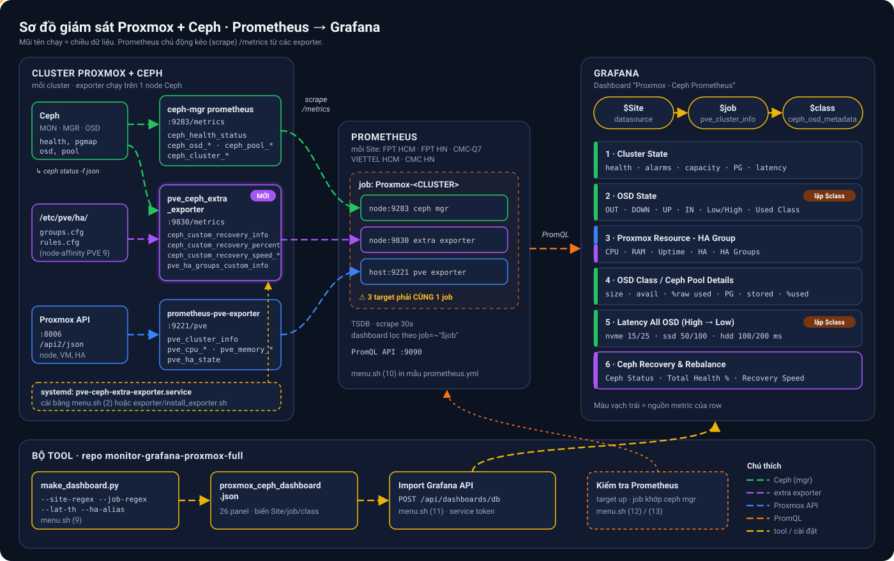

# Monitor Proxmox + Ceph (Prometheus / Grafana)



Bộ tool dựng dashboard **Proxmox - Ceph Prometheus** và lấp các ô đang báo `No data`.

| File | Việc |
|---|---|
| `menu.sh` | **Menu quản lý tất cả**: kiểm tra, cài, trạng thái, log, sinh/import dashboard, kiểm tra Prometheus |
| `make_dashboard.py` | Sinh JSON dashboard Grafana, import thẳng vào Grafana |
| `exporter/pve_ceph_extra_exporter.py` | Exporter bổ sung: trạng thái recovery/rebalance, Total Health %, Recovery Speed, HA Groups |
| `exporter/install_exporter.sh` | Cài exporter thành service systemd trên 1 node Proxmox |
| `alerts/pve-ceph-alerts.yml` | Alert rules Prometheus: exporter, Ceph, Proxmox |
| `tests/` | Unit test exporter (`python3 -m unittest discover -s tests`), chạy tự động trên GitHub Actions |
| `CHANGELOG.md` | Nhật ký thay đổi |

## Vì sao dashboard cũ có ô "No data"

| Ô | Nguyên nhân | Bản mới |
|---|---|---|
| OSD Used Class Nvme / HDD / HDD12T, Top 5 NVME/HDD/HDD12T Latency | Cluster không có OSD class đó, panel bị cố định theo tên class | Panel lặp theo biến `$class` (lấy từ `ceph_osd_metadata`), chỉ hiện class có OSD |
| Detailed Alarms | Cluster HEALTH_OK nên `ceph_health_detail` rỗng | Hiện dòng `OK / HEALTH_OK / Không có cảnh báo` |
| Ceph Status, Total Health, Recovery Speed | Không có nguồn cho `ceph_custom_recovery_*` | `pve_ceph_extra_exporter` luôn xuất metric (100% / 0 B/s khi không recovery) |
| Cột HA Groups | Thiếu `pve_ha_groups_custom_info` | Exporter đọc `/etc/pve/ha/groups.cfg` và `rules.cfg` (PVE 9) |

Sửa thêm các lỗi query của bản cũ:
- Bảng **Resource Cluster with HA Groups** không lọc `job` → trộn node của mọi cluster trên cùng Prometheus.
- **OSDs OUT** tính `count(up) - count(in)` luôn ra 0; nay đếm `ceph_osd_in == 0`.
- **OSD Used Class HDD12T** cột Low lấy nhầm class `hdd`.

## Cài trọn gói: một lệnh, hỏi một lần

Clone repo lên 1 node Ceph của mỗi cluster rồi chạy:

```bash
git clone https://github.com/fixnhanh-linux/monitor-grafana-proxmox-full.git /root/monitor-grafana-proxmox-full
```

```bash
bash /root/monitor-grafana-proxmox-full/menu.sh setup
```

(hoặc mở `menu.sh` rồi chọn **S**). Tool hỏi hết các câu dưới đây, in **TÓM TẮT**, hỏi `Bắt đầu thực hiện? (y/N)`, rồi tự chạy từng bước `>>> [1/6] ...` và báo **KẾT QUẢ**.

| # | Câu hỏi | Mặc định / tự dò | Dùng để |
|---|---|---|---|
| 1 | Máy này làm gì: `1` node Ceph đầy đủ · `2` chỉ exporter · `3` chỉ dashboard | `1` | Chọn các bước sẽ chạy |
| 2 | Port exporter | `9830` | Cổng `/metrics` của service |
| 2 | Gộp tất cả metric ra 1 port? | `Y` | `Y`: Prometheus chỉ cần 1 target; `n`: giữ target ceph mgr / pve exporter riêng |
| 2 | Tên job Prometheus của cluster | `Proxmox-<cluster_name>` đọc từ `/etc/pve/corosync.conf` | File mẫu `prometheus-target-<job>.yml` |
| 3 | Tiêu đề, UID dashboard | `Proxmox - Ceph Prometheus`, `pve-ceph-prom` | UID trùng sẽ ghi đè dashboard cũ |
| 3 | Regex lọc datasource Site, regex lọc job | trống (tất cả), `/.*Proxmox-/` | Biến `$Site`, `$job` |
| 3 | Số node / pool / device class | đọc từ `ceph osd tree`, `ceph osd pool ls`, `ceph osd crush class ls` | Chiều cao các bảng |
| 3 | Ngưỡng latency theo class | `nvme=15:25,ssd=50:100,default=100:200` | Màu bảng Latency All OSD |
| 3 | Khoảng thời gian mặc định | `now-15m` | Time picker |
| 3 | Đặt tên ngắn + màu cho HA Groups? | đọc các chuỗi group đang có trong `/etc/pve/ha/` | Cột HA Groups, vd `Gold+HIGH:orange` |
| 4 | Grafana URL, token, folder UID | URL trống = chỉ xuất file JSON | Import qua API |
| 5 | Prometheus URL | trống = bỏ qua | Kiểm tra target `up` và job khớp ceph mgr |

Các bước tool tự làm (tuỳ lựa chọn ở câu 1):

1. Kiểm tra môi trường — có lỗi thì dừng, chưa cài gì
2. Cài / cập nhật service `pve-ceph-extra-exporter`
3. In và lưu đoạn `prometheus.yml` mẫu (`prometheus-target-<job>.yml`)
4. Sinh `dashboard-local.json` (file riêng, không nằm trong git nên menu 14 cập nhật không bị chặn)
5. Import lên Grafana
6. Kiểm tra Prometheus

### Điều chỉnh sau khi cài

| Muốn đổi | Cách |
|---|---|
| Bất kỳ câu trả lời nào | Chạy lại `menu.sh setup` — giá trị cũ hiện sẵn trong `[ ]`, chỉ sửa câu cần đổi, Enter các câu khác |
| Sửa nhanh không qua câu hỏi | Sửa `.menu.conf` (dòng `DASH_TITLE=`, `DASH_LAT=`, `DASH_ALIASES=` ...) rồi chạy `menu.sh setup` và Enter liên tục |
| Chỉ port exporter | `bash menu.sh port 9300`, rồi sửa target trong `prometheus.yml` |
| Chỉ dashboard | Menu **9** (sinh lại) rồi **11** (import, UID giống nhau sẽ ghi đè) |
| Tên ngắn HA Groups | Menu **9** → trả lời `y` ở câu HA Groups; `DASH_ALIASES` lưu dạng `chuoi=Ten:mau;;chuoi2=Ten2` |
| Gỡ exporter | Menu **8** hoặc `bash menu.sh uninstall` |

Token Grafana: gõ 1 lần ở menu 11, chọn lưu thì nằm riêng trong `.grafana-token` (chỉ root đọc, không vào git, không nằm trong `.menu.conf`). Token sai / hết hạn thì tool tự xoá và hỏi lại; xoá tay ở menu 15.

## Menu từng mục

```bash
bash /root/monitor-grafana-proxmox-full/menu.sh
```

| Mục | Việc |
|---|---|
| S | Cài trọn gói (như trên) |
| 1 | Kiểm tra python3, lệnh `ceph`, keyring, HA config, port trống, PVE firewall |
| 2 | Cài / cập nhật exporter (hỏi port, mặc định 9830) |
| 3 | Trạng thái service, collector OK/lỗi, dòng Ceph Status, Total Health |
| 4 | Xem metric (nếu chưa cài thì chạy thử 1 lần từ file nguồn) |
| 5 / 6 / 7 / 8 | Log, restart, đổi port, gỡ cài |
| 9 | Sinh dashboard JSON — tự đọc số node / pool / device class từ Ceph |
| 10 | In đoạn `prometheus.yml` mẫu cho node này; máy có cluster từ xa thì gộp **tất cả cluster** vào `prometheus-scrape-all.yml` (kiểm tra từng exporter, bỏ job trùng, báo 2 cấu hình cùng 1 cluster), rồi tuỳ chọn đẩy qua SSH lên máy Prometheus, kèm alert rules (xem dưới) |
| 11 | Import dashboard lên Grafana qua API (service account token, role **Editor**); kiểm tra trước Grafana có datasource Prometheus khớp biến Site; Grafana dùng cert tự ký thì đề nghị **ghim cert** (so SHA-256 với trình duyệt), không tắt kiểm tra TLS |
| 12 | Hỏi Prometheus: target exporter có `up`, job của exporter có khớp job ceph mgr, device class từng cluster |
| 13 | Kiểm tra tổng thể (1 + 3 + 12) |
| 14 | Cập nhật tool (`git pull`), tự hỏi cài lại exporter nếu exporter có thay đổi |
| 15 | Xem / xoá cấu hình đã lưu (`.menu.conf`), **đặt Prometheus / Grafana URL** (kiểm tra kết nối) |
| 16 | Giới thiệu & bản quyền FIX NHANH |
| 17 | Thêm / sửa cluster theo dõi từ xa (API token) |
| 18 | Danh sách cluster từ xa: port, service, cluster thật đọc được, trạng thái từng phần; tô đỏ khi 2 cấu hình cùng 1 cluster hoặc trùng job |
| 19 | Kiểm tra kết nối 1 cluster (báo rõ 401 / 403 / firewall) |
| 20 | Xoá cluster từ xa (dừng service / container, xoá token) |
| 21 | Cài gói cần thiết — tự nhận `apt` / `dnf` / `yum` / `zypper` / `pacman` / `apk` |
| 22 | Mở firewall cho IP Prometheus — tự nhận `ufw` / `firewalld` / `pve-firewall` |
| 23 | Chạy cluster (đã thêm ở 17) bằng Docker: build image, chuyển từ systemd sang container cùng port |
| 24 | Quản lý container: xem trạng thái, log, khởi động lại, xoá (quay về systemd) |

Chạy 1 lệnh không qua menu: `bash menu.sh setup | check | install [port] | status | metrics | logs | restart | port <số> | uninstall | dashboard | import | prom | prom-check | doctor | update | about | remote-add [tên] | remote-list | prom-all | prom-push | prom-rules | urls | remote-test | remote-remove | deps | firewall | docker-run | docker-manage`.

Menu nhớ Grafana URL, Prometheus URL, tiêu đề/UID dashboard trong `.menu.conf`; token Grafana (nếu chọn lưu) nằm riêng ở `.grafana-token`.

## Theo dõi từ xa: không cài gì lên node Proxmox

Exporter chạy trên **máy monitor** (ví dụ 10.16.16.38, Ubuntu), lấy dữ liệu qua **API Proxmox** bằng token chỉ đọc và `/metrics` của ceph mgr. Một máy monitor theo dõi được nhiều cluster, mỗi cluster là 1 service `pve-ceph-extra-exporter@<tên>` với 1 port riêng (9830, 9831, ...). Tên metric giống hệt chế độ local nên **dashboard không cần sửa**.

| Dữ liệu | Chế độ local (trên node) | Chế độ remote (máy monitor) |
|---|---|---|
| Metric Ceph (OSD, pool, latency) | `ceph mgr services` → mgr:9283 | Thử lần lượt `CEPH_MGR`; để trống thì tự lấy IP mọi node từ `/cluster/status` (mgr standby trả rỗng → bỏ qua, tìm tới mgr active) |
| Node, CPU, RAM, uptime, HA | `pvesh`, `/etc/pve` | API `/cluster/status`, `/cluster/resources`, `/cluster/ha/status/manager_status` |
| Ceph Status / Recovery | `ceph status` | API `/cluster/ceph/status` |
| HA Groups | `/etc/pve/ha/*.cfg` | API `/cluster/ha/groups`, `/cluster/ha/rules` (PVE 9) |

### Bước 1: trên 1 node bất kỳ của mỗi cluster (1 lần)

```bash
pveum user add monitor@pve --comment "FIX NHANH monitor"
```

```bash
pveum acl modify / --users monitor@pve --roles PVEAuditor
```

```bash
pveum user token add monitor@pve exporter --privsep 0
```

```bash
ceph mgr module enable prometheus
```

`PVEAuditor` chỉ có quyền **xem**. Lệnh tạo token in ra `value` (secret) **chỉ một lần** — lưu lại.

### Bước 2: trên máy monitor

```bash
bash /root/monitor-grafana-proxmox-full/menu.sh remote-add
```

(hoặc menu **17**, hoặc cài trọn gói **S → 4**). Tool hỏi:

| Câu hỏi | Ví dụ / mặc định |
|---|---|
| Tên cluster | `FPT-HCM` |
| IP các node Proxmox | `10.16.16.60,10.16.16.61,10.16.16.62` — node đầu chết tự chuyển node sau |
| Token ID / secret | `monitor@pve!exporter` / secret (gõ không hiện) |
| Kiểm tra chứng chỉ TLS | `N` (Proxmox mặc định cert tự ký) |
| Ceph mgr | Enter = tự tìm mgr active trên mọi node của cluster (`:9283`) |
| Tên job Prometheus | `Proxmox-FPT-HCM` (phải chứa `Proxmox-`) |
| Port | port trống kế tiếp từ 9830 |

Tool **chạy thử kết nối** và báo từng phần ✔ / ✘ (401 = sai token, 403 = thiếu quyền, refused/timeout = firewall), sau đó lưu `/etc/pve-ceph-extra-exporter/<tên>.env` (chmod 600, chỉ root đọc), bật service và in mẫu `prometheus.yml` (1 target `IP-máy-monitor:port`).

Máy monitor cần đi tới được **node:8006** và **mgr:9283**.

### An toàn & tải

- Service chạy bằng **user tạm** (`DynamicUser`), không phải root; hệ thống file chỉ đọc (`ProtectSystem=strict`); giới hạn `CPUQuota=25%`, `MemoryMax=256M`.
- Token chỉ nằm trong file `.env` quyền 600, không xuất hiện trên dòng lệnh / `ps`.
- Mỗi 30 giây: 5–6 request API + 1 request mgr cho mỗi cluster. Phía Proxmox gần như không tốn gì.

### Chạy trên server không phải Ubuntu

| Hệ điều hành | Ghi chú |
|---|---|
| Debian, Ubuntu, Rocky / Alma / RHEL 8+, Fedora, openSUSE, Arch | Đầy đủ: menu **21** cài gói, **17** thêm cluster |
| CentOS 7 / RHEL 7 | Chạy được; systemd cũ bỏ qua `DynamicUser` nên service chạy bằng root |
| Alpine, máy không có systemd, Windows (Docker Desktop / WSL2) | Dùng Docker: menu **17** rồi **23** |

Firewall (ufw / firewalld / pve-firewall): menu **22**, nhập IP Prometheus là mở đủ các port exporter trên máy.

### Docker

Thêm cluster ở menu **17** (để có file cấu hình), rồi menu **23**: tool build image `fixnhanh/pve-ceph-exporter:<version>`, dừng service systemd của cluster đó và chạy container `fixnhanh-pve-<tên>` cùng port (giới hạn 256 MB / 0.25 CPU, read-only, bỏ mọi capability). Target Prometheus giữ nguyên. Menu **24** xem log / khởi động lại / xoá container (tự quay về systemd).

Chạy tay không qua menu:

```bash
docker build -t fixnhanh/pve-ceph-exporter exporter/
```

```bash
docker run -d --name fixnhanh-pve-FPT-HCM --restart unless-stopped -p 9830:9830 --env-file /etc/pve-ceph-extra-exporter/FPT-HCM.env fixnhanh/pve-ceph-exporter
```

## 1. Cài exporter thủ công (trên 1 node Ceph của mỗi cluster)

```bash
scp -r exporter root@<node-proxmox>:/root/
```

```bash
bash /root/exporter/install_exporter.sh
```

Kiểm tra nhanh không cần cài: `python3 pve_ceph_extra_exporter.py --once`

## 2. Thêm vào Prometheus

### Mặc định: gộp tất cả metric ra 1 port

Exporter phát lại `/metrics` của ceph mgr đang active (lấy địa chỉ qua `ceph mgr services`) và tự xuất metric Proxmox từ `pvesh` (tên giống `prometheus-pve-exporter`: `pve_cluster_info`, `pve_up`, `pve_cpu_usage_ratio`, `pve_memory_*`, `pve_disk_*`, `pve_uptime_seconds`, `pve_ha_state`). Mỗi cluster chỉ cần **1 target**:

```yaml
  - job_name: Proxmox-DECO
    scrape_interval: 30s
    scrape_timeout: 25s
    static_configs:
      - targets:
          - 10.0.0.11:9830   # pve_ceph_extra_exporter (tất cả metric)
```

Điều kiện: đã bật module prometheus của ceph mgr (`ceph mgr module enable prometheus`), menu **1** sẽ kiểm tra.

**Phải xoá** target `:9283` (ceph mgr) và `:9221` (pve exporter) cũ của cluster đó khỏi job, nếu không mọi số liệu bị nhân đôi. Menu **12** báo `Trùng` khi một job có 2 target cùng xuất metric ceph hoặc Proxmox.

### Nhiều cluster trên 1 máy monitor

Menu **10** (hoặc `bash menu.sh prom-all`) gộp mọi cluster thành `prometheus-scrape-all.yml`, file đã có sẵn dòng `scrape_configs:`.

| Prometheus của bạn | Cách đưa vào |
|---|---|
| Tách file: `prometheus.yml` có `scrape_config_files: [/etc/prometheus/scrape_configs/*.yml]` | Chép **nguyên file** vào thư mục đó, vd `proxmox-ceph-<tên-máy-monitor>.yml` |
| 1 file (mặc định) | Dán các khối `- job_name:` vào dưới `scrape_configs:` của `prometheus.yml` |

Với kiểu tách file, trả lời `y` ở câu *Đẩy file lên máy Prometheus qua SSH* (hoặc `bash menu.sh prom-push`). Tool tự làm:

1. SSH vào máy Prometheus (cần đăng nhập bằng key: `ssh-copy-id root@<prometheus>`), kiểm tra thư mục và `scrape_config_files`.
2. **Dừng** nếu `job_name` đã có ở file khác — Prometheus không cho trùng job giữa các file.
3. Liệt kê target `:9283` / `:9221` cũ để bạn xoá nếu là cùng cluster (tránh nhân đôi số liệu).
4. Chép file, chạy `promtool check config`; lỗi thì **trả lại file cũ**, Prometheus không bị ảnh hưởng; OK thì reload.

Máy SSH, file cấu hình, thư mục được nhớ trong `.menu.conf` cho lần sau.

Sau khi đẩy file scrape, tool hỏi đẩy luôn **alert rules** (hoặc `bash menu.sh prom-rules`): chép `alerts/pve-ceph-alerts.yml` vào thư mục `rule_files` đang dùng (mặc định lấy từ `prometheus.yml`, vd `/etc/prometheus/rules/`). Nếu `prometheus.yml` chưa nạp thư mục đó, tool thêm dòng vào `rule_files` (giữ bản sao `.bak`). `promtool check rules` + `check config` lỗi thì trả lại cả 2 file.

Đầu menu hiện mã commit đang chạy (vd `2026.10.30 · de76e86`); GitHub có bản mới hơn thì hiện dòng **Có bản mới → chọn 14**.

### Không gộp (giữ target cũ)

Chọn `n` ở câu gộp (service chạy với `--no-ceph-mgr --no-pve`). Target exporter phải nằm **cùng job** với ceph mgr / pve exporter của cluster đó (dashboard lọc theo `job=~"$job"`):

```yaml
  - job_name: Proxmox-DECO
    static_configs:
      - targets:
          - 10.0.0.11:9283   # ceph mgr prometheus (đã có)
          - 10.0.0.11:9830   # pve_ceph_extra_exporter (mới)
```

### Cảnh báo (alert rules)

File `alerts/pve-ceph-alerts.yml` có sẵn các rule, chỉ áp cho job chứa `Proxmox-`:

| Nhóm | Alert | Khi nào |
|---|---|---|
| Exporter | `PveCephExporterDown` | Target không scrape được 2 phút |
| | `PveCephExporterCollectorFailed` | Một collector lỗi 5 phút (ô dashboard tương ứng sẽ No data) |
| | `PveCephExporterStale` | Không thu thập mới quá 3 phút (lệnh ceph / API treo) |
| Ceph | `CephHealthError` / `CephHealthWarning` | HEALTH_ERR 1 phút / HEALTH_WARN 15 phút |
| | `CephOsdDown` / `CephOsdOut` | OSD down 5 phút / out 15 phút |
| | `CephOsdNearFull` / `CephOsdFull` | OSD dùng > 85% / > 90% |
| | `CephPoolNearFull` | Pool dùng > 80% |
| | `CephPgInconsistent`, `CephUnfoundObjects` | Có PG inconsistent / object unfound |
| | `CephRecoveryTooLong` | Recovery / rebalance quá 6 giờ |
| | `CephOsdHighLatency` | Apply latency > 200 ms trong 10 phút |
| Proxmox | `PveNodeDown`, `PveClusterNotQuorate`, `PveHaNodeFenced` | Node offline, mất quorum, HA fence / lost |
| | `PveNodeHighCpu` / `PveNodeHighMemory` | CPU / RAM > 90% trong 15 phút |

Chép file lên máy Prometheus rồi thêm vào `prometheus.yml`:

```yaml
rule_files:
  - /etc/prometheus/rules/pve-ceph-alerts.yml
```

```bash
promtool check rules /etc/prometheus/rules/pve-ceph-alerts.yml
```

Sau đó reload Prometheus. Gửi cảnh báo đi (Telegram, email ...) cấu hình ở Alertmanager. Ngưỡng và thời gian `for:` sửa thẳng trong file.

## 3. Sinh và import dashboard

```bash
python make_dashboard.py -o proxmox_ceph_dashboard.json
```

Tuỳ chọn:

```bash
python make_dashboard.py --title "Proxmox - Ceph DECO" --uid pve-ceph-deco --site-regex "/^Prometheus (FPT HN|CMC-Q7)$/" --nodes 5 --pools 4 --classes 1
```

- `--site-regex`: lọc datasource Prometheus cho biến **Site**
- `--job-regex`: lọc job của `pve_cluster_info` (mặc định `/.*Proxmox-/`)
- `--nodes / --pools / --classes`: chỉnh chiều cao các bảng cho vừa số dòng
- `--lat-th`: ngưỡng latency (ms) cảnh báo:nghiêm trọng theo class, mặc định `nvme=15:25,ssd=50:100,default=100:200`
- `--ha-alias "GROUPS=TEXT[:màu]"` (lặp được): tên ngắn và màu cho chuỗi HA Groups, vd `--ha-alias "Gold-6146,HIGH-FREQUENCY,P1-XD=Gold+HIGH+P1-XD:orange"`
- `--time-from`: khoảng thời gian mặc định, vd `now-5m`

Ví dụ dựng lại dashboard CMC Q7 / FPT HCM / VIETTEL HCM / CMC HN:

```bash
python make_dashboard.py -o cmc.json --title "Proxmox - Ceph Prometheus CMC Q7 - FPT HCM - VIETTEL HCM - CMC HN" --uid fix --time-from now-5m --site-regex "/^(Prometheus FPT HCM|Prometheus FPT HN|Prometheus CMC-Q7|Prometheus VIETTEL HCM|Prometheus CMC HN)$/" --job-regex "/^(?!.*Proxmox-Cluster-DMS|.*Test|.*Deco).*Proxmox-/" --ha-alias "BASIC-COMPUTING,INTEL-HIGH-CPU,P1-XD=BASIC+INTEL+P1-XD:purple" --ha-alias "Gold-6146,HIGH-FREQUENCY,P1-XD=Gold+HIGH+P1-XD:orange" --ha-alias "Gold-8260,INTEL-HIGH-CPU,Platinum-8260=Gold+INTEL+Platinum:blue" --ha-alias "Gold-8260,INTEL-HIGH-CPU,P1-XD,Platinum-8260=Gold+INTEL+P1+Platinum:green"
```

Lưu ý: import với `--uid fix` sẽ ghi đè dashboard đang có uid `fix`.

Grafana → Dashboards → New → Import → chọn file JSON.

## Metric của exporter

| Metric | Ý nghĩa |
|---|---|
| `ceph_custom_recovery_info{content,state}` | Dòng trạng thái; giá trị 0 = OK, 1 = recovery/rebalance, 2 = lỗi |
| `ceph_custom_recovery_percent` | % dữ liệu ổn định (100 khi không có degraded/misplaced) |
| `ceph_custom_recovery_speed_bytes` | Tốc độ recovery (bytes/s) |
| `ceph_custom_recovery_objects_per_sec` | Object recovery / giây |
| `ceph_custom_degraded_objects`, `_misplaced_objects`, `_unfound_objects` | Số object bất thường |
| `ceph_custom_pgs_not_clean` | Số PG không active+clean |
| `ceph_custom_progress_percent{event}` | Tiến độ các sự kiện `ceph progress` |
| `pve_ha_groups_custom_info{host,groups}` | HA group / node-affinity rule của node |

Cột **HA** và **HA Groups** trong bảng *Resource Cluster* chỉ hiện khi cluster đang chọn ở biến `$job` có HA group / node-affinity rule; cluster không có HA thì hai cột này tự ẩn.

Metric tự giám sát của exporter (hàng **Exporter** cuối dashboard):

| Metric | Ý nghĩa |
|---|---|
| `pve_ceph_extra_exporter_up{collector}` | 1 = thu thập OK. Collector: `ceph_mgr`, `pve`, `ceph`, `ha` (`ceph_mgr` / `pve` không có khi chạy `--no-ceph-mgr` / `--no-pve`) |
| `pve_ceph_extra_exporter_last_error{collector,error}` | Lỗi gần nhất của collector đang hỏng (401, timeout, mgr standby ...) |
| `pve_ceph_extra_exporter_collect_seconds{collector}` | Thời gian thu thập lần gần nhất (giây) |
| `pve_ceph_extra_exporter_last_collect_timestamp` | Thời điểm thu thập gần nhất (unix) — dùng để phát hiện dữ liệu cũ |
| `pve_ceph_extra_exporter_mode{mode}` | `local` / `remote` |
| `pve_ceph_extra_exporter_build_info{version}` | Phiên bản exporter |

Ngoài `/metrics`, exporter có `/health`: `200 ok` khi lần thu thập gần nhất còn mới, `503 stale` khi vòng thu thập treo quá `3 × INTERVAL` (tối thiểu 120 s). Docker image dùng nó cho `HEALTHCHECK`, nên container treo hiện `unhealthy` trong `docker ps`.

---

Bản quyền © 2026 **FIX NHANH**. Bảo lưu mọi quyền — xem [LICENSE](LICENSE).
