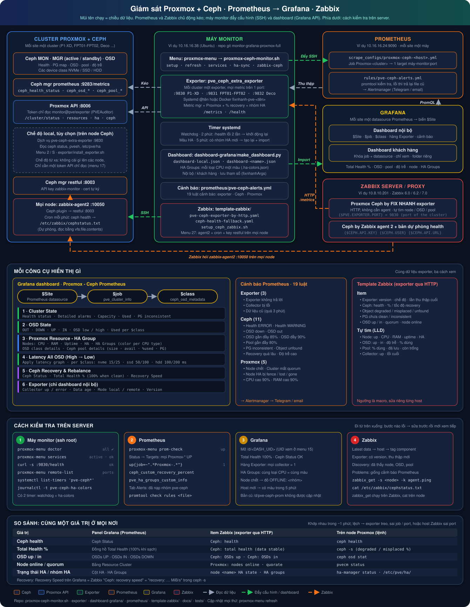

# Monitor Proxmox + Ceph (Prometheus / Grafana / Zabbix)

Click a language to open it · Bấm vào ngôn ngữ để mở

<details>
<summary><b>🇬🇧 English</b></summary>


A toolkit that builds the **Proxmox - Ceph Prometheus** Grafana dashboard and fills every panel that used to show `No data`.

| Path | Purpose |
|---|---|
| `proxmox-ceph-monitor.sh` | **Management menu for everything** (`proxmox-menu`): checks, install, status, logs, dashboards, Prometheus, Zabbix, Docker, services. Named `proxmox-<what it does>.sh` so other Proxmox tools can sit next to it; `menu.sh` is the old name, kept and forwarding to it |
| `exporter/` | `pve_ceph_extra_exporter.py` (recovery / rebalance, Total Health %, Recovery Speed, HA Groups; re-serves ceph mgr + Proxmox metrics on one port), `install_exporter.sh`, systemd unit `pve-ceph-extra-exporter@.service`, `Dockerfile` |
| `dashboard-grafana/` | `make_dashboard.py` (dashboard generator) and `proxmox_ceph_dashboard.json` (default dashboard, ready to import) |
| `prometheus/` | `pve-ceph-alerts.yml` — Prometheus alert rules: exporter, Ceph, Proxmox |
| `template-zabbix/` | Zabbix templates (6.0+): `pve-ceph-exporter-by-http.yaml` (reads the exporter over HTTP, no agent), `ceph-health-fallback.yaml`; `setup_ceph_zabbix.sh` (Zabbix Agent 2 for Ceph on every node over SSH) |
| `docs/` | Architecture diagram in English and Vietnamese (`make_vi_svg.py` makes the Vietnamese one from the English one) |
| `lang/` | Menu translations: `vi.txt` (Vietnamese, unaccented), one line per text: `English => Vietnamese` |
| `tests/` | Unit tests (`python3 -m unittest discover -s tests`), run on GitHub Actions; CI also imports the Zabbix templates into real Zabbix 6.0, 6.2 and 7.0 |
| `CHANGELOG.md` | Change log |

Generated on the host (not in git): `dashboard-local.json`, `dashboard-<name>.json`, `prometheus-scrape-all.yml`, `.menu.conf`, `.grafana-token`, `.grafana-cert.pem`, `.ha-colors.json`, `.ha-groups.seen`, `.menu-pin`.

## Why the old dashboard showed "No data"

| Panel | Cause | New version |
|---|---|---|
| OSD Used Class Nvme / HDD / HDD12T, Top 5 NVME/HDD/HDD12T Latency | The cluster has no OSD of that class, panels were hard-coded per class | Panels repeat over the `$class` variable (from `ceph_osd_metadata`), only existing classes are shown |
| Detailed Alarms | Cluster is HEALTH_OK so `ceph_health_detail` is empty | Shows `OK / HEALTH_OK / No alarms` |
| Ceph Status, Total Health, Recovery Speed | Nothing exported `ceph_custom_recovery_*` | `pve_ceph_extra_exporter` always exports them (100% / 0 B/s without recovery) |
| HA Groups column | `pve_ha_groups_custom_info` missing | The exporter reads `/etc/pve/ha/groups.cfg` and `rules.cfg` (PVE 9) |

Query bugs fixed from the old dashboard:
- **Resource Cluster with HA Groups** did not filter on `job` → nodes of every cluster on the same Prometheus were mixed.
- **OSDs OUT** computed `count(up) - count(in)`, always 0; now counts `ceph_osd_in == 0`.
- **OSD Used Class HDD12T** took its Low column from class `hdd`.

## Check it on the servers

Go top to bottom; when a step fails, fix it before looking further (same as the bottom of the diagram).

| Where | Command / place | Expected |
|---|---|---|
| Monitor host | `proxmox-menu doctor` | every line ✔ |
| Monitor host | `proxmox-menu services` | every exporter `active`, `/health ok` |
| Monitor host | `curl -s http://127.0.0.1:9830/health` (each cluster port: `proxmox-menu remote-list`) | `ok` |
| Monitor host | `systemctl list-timers 'pve-ceph*'` · `journalctl -t pve-ceph-ha-colors -n 20` | watchdog + ha-colors timers listed; "No new HA groups" or the regenerate lines |
| Prometheus | `proxmox-menu prom-check`, or **Status → Targets** | every `Proxmox-*` target UP, job matches the ceph mgr job |
| Prometheus | query `ceph_custom_recovery_percent`, `pve_ha_groups_custom_info` | one series per cluster / node |
| Prometheus | **Alerts** tab, `promtool check rules /etc/prometheus/rules/pve-ceph-alerts.yml` | group `pve-ceph` loaded, `SUCCESS` |
| Grafana | `/d/<DASH_UID>` (UID in menu 15) | Total Health `100%`, Ceph Status OK, Exporter row all `1`; same CPU type = same HA Groups color; a down node shows red `OFFLINE: …` |
| Zabbix | **Monitoring → Latest data** → host, tag `component` | exporter version + recent "last collect"; nodes / OSDs / pools discovered |
| Zabbix | `zabbix_get -s <node> -k agent.ping` (on the Zabbix server) · `cat /etc/zabbix/cephstatus.txt` (on a node) | `1` · `HEALTH_OK` |

**Compare the same value in every place** (equal within ~1 minute; a difference means a stale exporter, a wrong job / port, or the Zabbix host pointing at the wrong port):

| What | Grafana | Zabbix (exporter by HTTP) | On a Proxmox node |
|---|---|---|---|
| Ceph health | Ceph Status | `Ceph: health` | `ceph health` |
| Total Health % | Total Health | `Ceph: total health (data stable)` | `ceph -s` (degraded / misplaced %) |
| OSDs up / in | OSDs UP / IN / DOWN | `Ceph: OSDs up`, `Ceph: OSDs in` | `ceph osd stat` |
| Nodes online / quorum | Resource Cluster | `Proxmox: nodes online`, `Proxmox: cluster quorate` | `pvecm status` |
| HA state / groups | HA, HA Groups | `Proxmox: node <name> HA state / HA groups` | `ha-manager status`, `/etc/pve/ha/` |
| Recovery speed | Recovery Speed | `Ceph: recovery speed` | `recovery: … MiB/s` in `ceph -s` |

## Install: one command, asks once

Clone the repo on one Ceph node of each cluster (or on a separate monitor host, see *Remote monitoring*) and run:

```bash
git clone https://github.com/fixnhanh-linux/monitor-grafana-proxmox-full.git /root/monitor-grafana-proxmox-full
```

```bash
bash /root/monitor-grafana-proxmox-full/proxmox-ceph-monitor.sh setup
```

(or open the menu and pick **S**). The tool asks all questions below, prints a **SUMMARY**, asks `Start? (y/N)`, then runs every step and reports the result.

| # | Question | Default / detected | Used for |
|---|---|---|---|
| 1 | What is this host for: `1` full Ceph node · `2` exporter only · `3` dashboard only · `4` remote monitor | `1` | Which steps run |
| 2 | Exporter port | `9830` | The service's `/metrics` port |
| 2 | Serve all metrics on 1 port? | `Y` | `Y`: Prometheus needs only 1 target; `n`: keep separate ceph mgr / pve exporter targets |
| 2 | Prometheus job name | `Proxmox-<cluster_name>` from `/etc/pve/corosync.conf` | Sample `prometheus-target-<job>.yml` |
| 3 | Dashboard title, UID | `Proxmox - Ceph Prometheus`, `pve-ceph-prom` | Same UID overwrites the old dashboard |
| 3 | Site datasource regex, job regex | empty (all), `/.*Proxmox-/` | `$Site`, `$job` variables |
| 3 | Node / pool / device class counts | from `ceph osd tree`, `ceph osd pool ls`, `ceph osd crush class ls` | Table heights |
| 3 | Latency thresholds per class | `nvme=15:25,ssd=50:100,default=100:200` | Colors of the OSD latency tables |
| 3 | Default time range | `now-15m` | Time picker |
| 3 | Short names + colors for HA Groups? | group strings found in `/etc/pve/ha/` | HA Groups column, e.g. `Gold+HIGH:purple` |
| 4 | Grafana URL, token, folder UID | empty URL = JSON file only | Import over the API |
| 5 | Prometheus URL | empty = skip | Checks the target is `up` and the job matches ceph mgr |

Steps run by the tool (depending on answer 1):

1. Environment check — stops on errors, nothing installed yet
2. Install / update the `pve-ceph-extra-exporter` service
3. Print and save a sample `prometheus.yml` block (`prometheus-target-<job>.yml`)
4. Generate `dashboard-local.json` (not tracked by git, so updates are never blocked)
5. Import to Grafana
6. Check Prometheus

### Changing things later

| To change | How |
|---|---|
| Any answer | Run `proxmox-menu setup` again — current values are prefilled in `[ ]`, press Enter to keep them |
| Quick edit without questions | Edit `.menu.conf` (`DASH_TITLE=`, `DASH_LAT=`, `DASH_ALIASES=` ...) then run `proxmox-menu refresh` |
| Exporter port only | `proxmox-menu port 9300`, then update the target in Prometheus |
| Dashboard only | Menu **9** (generate) then **11** (import; the same UID overwrites) |
| HA Groups short names | Menu **9** → answer `y` to the HA Groups question; `DASH_ALIASES` is stored as `string=Name:color;;string2=Name2` |
| Remove the exporter | Menu **8** or `proxmox-menu uninstall` |

Grafana token: entered once in menu 11; if you choose to save it, it is kept in `.grafana-token` (root-only, not in git, not in `.menu.conf`). An invalid / expired token is deleted automatically and asked again; delete it by hand in menu 15.

## Update everything: one command, no questions

```bash
proxmox-menu refresh
```

Runs `git pull`, restarts itself on the new code, then with the saved config: reinstalls the exporter (local + every remote cluster, systemd or Docker) and restarts it, regenerates every dashboard file and imports it to Grafana (needs the Grafana URL + token saved in menu 11), prints the service table and checks Prometheus. It ends with `Done, no errors` or the list of steps that need attention.

## The `proxmox-menu` shortcut

The first time `bash /root/monitor-grafana-proxmox-full/proxmox-ceph-monitor.sh` runs as root, the tool creates `/usr/local/bin/proxmox-menu`. From then on, from any directory:

| Command | Purpose |
|---|---|
| `proxmox-menu` | Open the menu |
| `proxmox-menu refresh` | Update everything (git pull + exporter + dashboards + checks) |
| `proxmox-menu services` | Service table: restart / stop / logs |
| `proxmox-menu <command>` | Any command below (`remote-list`, `prom-push`, `docker-net` ...) |

If you move the tool folder, run `bash <new-folder>/proxmox-ceph-monitor.sh` once and the shortcut follows.

## Menu items

| Item | Purpose |
|---|---|
| S | Full setup (above) |
| 1 | Check python3, `ceph`, keyring, HA config, free port, PVE firewall |
| 2 | Install / update the exporter (asks for the port, default 9830) |
| 3 | Service status, collectors OK / failing, Ceph Status line, Total Health |
| 4 | Show metrics (one-shot run from source if not installed) |
| 5 / 6 / 7 / 8 | Logs, restart, change port, uninstall |
| 9 | Generate the dashboard — node / pool / device class counts read from Ceph. Pick **1 Internal** (all clusters) or **2 Customer** (see below) |
| 10 | Sample `prometheus.yml` for this node; with remote clusters, merges **all clusters** into `prometheus-scrape-all.yml` (checks each exporter, skips duplicate jobs, flags two configs for the same cluster), then optionally pushes it to the Prometheus host over SSH, with the alert rules (see below) |
| 11 | Import a dashboard to Grafana over the API (service account token, **Editor** role); checks first that Grafana has a Prometheus datasource matching the Site variable; with a self-signed Grafana cert it offers to **pin the cert** (compare SHA-256 with the browser) instead of disabling TLS checks; keeps the dashboard's current folder |
| 12 | Ask Prometheus: exporter targets `up`, exporter job matches the ceph mgr job, device classes per cluster |
| 13 | Full check (1 + 3 + 12) |
| 14 | Update the tool (`git pull`), offers to reinstall the exporter if it changed |
| 15 | Show / delete the saved config (`.menu.conf`), **set the Prometheus / Grafana URLs** (with a connection check) |
| 16 | About & license |
| 17 | Add / edit a remotely monitored cluster (API token) |
| 18 | Remote clusters: port, service, real cluster read, state of each part; red when two configs read the same cluster or share a job |
| 19 | Test one cluster's connection (explains 401 / 403 / firewall) |
| 20 | Remove a remote cluster (stops the service / container, deletes the token) |
| 21 | Install required packages — detects `apt` / `dnf` / `yum` / `zypper` / `pacman` / `apk` |
| 22 | Open the firewall for the Prometheus IP — detects `ufw` / `firewalld` / `pve-firewall` |
| 23 | Run clusters (added in 17) in Docker: builds the image, moves from systemd to a container on the same port |
| 24 | Manage containers: status, logs, restart, remove (back to systemd) |
| 25 | Change the Docker IP range (`docker0` + range for new networks): checks private range / route overlap, backs up `daemon.json`, restarts Docker, checks containers come back; restores the old file if Docker fails |
| 26 | **Services & health**: table of every exporter (local, `@cluster`, container) + Docker + watchdog with state, `/health`, port, start on boot; `r`/`s`/`t` restart / stop / start (one or `a` = all) then **verifies** active + `/health` within 40 s and prints logs on failure; `l` logs; `b`/`B` enable / disable start on boot; `w` watchdog |
| 27 | **Zabbix: Ceph via Zabbix Agent 2** — runs `template-zabbix/setup_ceph_zabbix.sh` (see *Zabbix* below) |
| L | Menu language: English or Vietnamese (unaccented, for server terminals); also `proxmox-menu lang vi` / `proxmox-menu lang en`. Saved in `.menu.conf` |
| P | Menu PIN (or `proxmox-menu pin`): once set, opening the menu and typed commands ask for it (3 tries); `refresh`, the HA colors timer and the watchdog never ask. Stored hashed in `.menu-pin`; forgot it → as root `rm .menu-pin` in the tool folder. A convenience lock, not real security (root can always remove it) |
| O | **Operator users** (or `proxmox-menu operator add <user>`): creates a login account that is **not root** and may only run `sudo proxmox-menu` (sudoers entry for that one command, checked with `visudo`). For an operator the PIN is asked on every run, even without a terminal, and it cannot change the PIN or the operators; the tool folder is made root-writable only. This is what makes the PIN effective: root itself can always bypass it. `operator remove <user>` takes the right away |

Run a single command without the menu: `proxmox-menu setup | check | install [port] | status | metrics | logs | restart | port <number> | uninstall | dashboard | import | prom | prom-check | doctor | update | refresh | about | remote-add [name] | remote-list | remote-test | remote-remove | prom-all | prom-push | prom-rules | urls | deps | firewall | docker-run | docker-manage | docker-net | services | watchdog | zabbix-ceph | ha-sync | lang [en|vi] | pin | operator [add|remove|list] [user]`.

The menu remembers the Grafana URL, Prometheus URL, dashboard title / UID in `.menu.conf`; the Grafana token (if saved) lives separately in `.grafana-token`.

## Remote monitoring: nothing installed on the Proxmox nodes

The exporter runs on a **monitor host** (e.g. 10.16.16.38, Ubuntu) and collects over the **Proxmox API** with a read-only token plus the ceph mgr `/metrics`. One monitor host can watch many clusters, each cluster being one `pve-ceph-extra-exporter@<name>` service on its own port (9830, 9831, ...). Metric names are identical to local mode, so **the dashboard does not change**.

| Data | Local mode (on a node) | Remote mode (monitor host) |
|---|---|---|
| Ceph metrics (OSD, pool, latency) | `ceph mgr services` → mgr:9283 | Tries `CEPH_MGR` in turn; empty = every node IP from `/cluster/status` (standby mgrs return nothing → skipped until the active mgr) |
| Nodes, CPU, RAM, uptime, HA | `pvesh`, `/etc/pve` | API `/cluster/status`, `/cluster/resources`, `/cluster/ha/status/manager_status` |
| Ceph Status / Recovery | `ceph status` | API `/cluster/ceph/status` |
| HA Groups | `/etc/pve/ha/*.cfg` | API `/cluster/ha/groups`, `/cluster/ha/rules` (PVE 9) |

### Step 1: on any node of each cluster (once)

```bash
pveum user add monitor@pve --comment "FIX NHANH monitor"
```

```bash
pveum acl modify / --users monitor@pve --roles PVEAuditor
```

```bash
pveum user token add monitor@pve exporter --privsep 0
```

```bash
ceph mgr module enable prometheus
```

`PVEAuditor` can only **read**. The token command prints the `value` (secret) **only once** — keep it.

### Step 2: on the monitor host

```bash
proxmox-menu remote-add
```

(or menu **17**, or full setup **S → 4**). The tool asks:

| Question | Example / default |
|---|---|
| Cluster name | `FPT-HCM` |
| Proxmox node IPs | `10.16.16.60,10.16.16.61,10.16.16.62` — fails over to the next node if one dies |
| Token ID / secret | `monitor@pve!exporter` / secret (hidden) |
| Does Proxmox have a valid cert? | `N` (Proxmox ships a self-signed cert) |
| Ceph mgr | Enter = auto-find the active mgr on every node (`:9283`) |
| Prometheus job name | `Proxmox-FPT-HCM` (must contain `Proxmox-`) |
| Port | next free port from 9830 |

The tool **tests the connection** and reports each part ✔ / ✘ (401 = wrong token, 403 = missing permission with the exact `pveum` command to fix it, refused / timeout = firewall), then saves `/etc/pve-ceph-extra-exporter/<name>.env` (chmod 600, root-only), starts the service and prints a sample Prometheus block (1 target `monitor-IP:port`).

The monitor host must reach **node:8006** and **mgr:9283**.

### Security & load

- The service runs as a **transient user** (`DynamicUser`), not root; read-only filesystem (`ProtectSystem=strict`); limited to `CPUQuota=25%`, `MemoryMax=256M`.
- The token only lives in the mode-600 `.env` file, never on the command line / in `ps`.
- Every 30 seconds: 5–6 API requests + 1 mgr request per cluster. Negligible load on Proxmox.

### Non-Ubuntu servers

| OS | Notes |
|---|---|
| Debian, Ubuntu, Rocky / Alma / RHEL 8+, Fedora, openSUSE, Arch | Full support: menu **21** installs packages, **17** adds clusters |
| CentOS 7 / RHEL 7 | Works; old systemd ignores `DynamicUser` so the service runs as root |
| Alpine, hosts without systemd, Windows (Docker Desktop / WSL2) | Use Docker: menu **17** then **23** |

Firewall (ufw / firewalld / pve-firewall): menu **22**, enter the Prometheus IP and every exporter port on the host is opened.

### Docker

Add the cluster in menu **17** (to get its config file), then menu **23**: the tool builds `fixnhanh/pve-ceph-exporter:<version>`, stops that cluster's systemd service and runs container `fixnhanh-pve-<name>` on the same port (256 MB / 0.25 CPU, read-only, all capabilities dropped). The Prometheus target does not change. Menu **24** shows logs / restarts / removes containers (back to systemd). `proxmox-menu refresh` rebuilds the image and recreates the containers when the exporter version changes.

Manual run without the menu:

```bash
docker build -t fixnhanh/pve-ceph-exporter exporter/
```

```bash
docker run -d --name fixnhanh-pve-FPT-HCM --restart unless-stopped -p 9830:9830 --env-file /etc/pve-ceph-extra-exporter/FPT-HCM.env fixnhanh/pve-ceph-exporter
```

## 1. Manual exporter install (on one Ceph node of each cluster)

```bash
scp -r exporter root@<proxmox-node>:/root/
```

```bash
bash /root/exporter/install_exporter.sh
```

Quick test without installing: `python3 pve_ceph_extra_exporter.py --once`

## 2. Add to Prometheus

### Default: all metrics on one port

The exporter re-serves the `/metrics` of the active ceph mgr (address from `ceph mgr services`) and exports Proxmox metrics from `pvesh` (same names as `prometheus-pve-exporter`: `pve_cluster_info`, `pve_up`, `pve_cpu_usage_ratio`, `pve_memory_*`, `pve_disk_*`, `pve_uptime_seconds`, `pve_ha_state`). Each cluster needs **one target**:

```yaml
  - job_name: Proxmox-DECO
    scrape_interval: 30s
    scrape_timeout: 25s
    static_configs:
      - targets:
          - 10.0.0.11:9830   # pve_ceph_extra_exporter (all metrics)
```

Requirement: the ceph mgr prometheus module is enabled (`ceph mgr module enable prometheus`); menu **1** checks it.

**Remove** the cluster's old `:9283` (ceph mgr) and `:9221` (pve exporter) targets from the job, otherwise every value is doubled. Menu **12** reports duplicates when a job has two targets exporting ceph or Proxmox metrics.

### Many clusters on one monitor host

Menu **10** (or `proxmox-menu prom-all`) merges every cluster into `prometheus-scrape-all.yml`, which already starts with `scrape_configs:`.

| Your Prometheus | How to add it |
|---|---|
| Split files: `prometheus.yml` has `scrape_config_files: [/etc/prometheus/scrape_configs/*.yml]` | Copy the **whole file** into that directory, e.g. `proxmox-ceph-<monitor-host>.yml` |
| Single file (default) | Paste the `- job_name:` blocks under `scrape_configs:` in `prometheus.yml` |

With split files, answer `y` to *Push the file to the Prometheus host over SSH* (or `proxmox-menu prom-push`). The tool:

1. SSHes to the Prometheus host (offers to create a key + `ssh-copy-id`; otherwise the password is asked once per run), checks the directory and `scrape_config_files`.
2. Lists existing jobs with the **same name** or the **same target** as the exporter and offers to **replace** them: backs up the whole directory to `/root/prom-bak-<time>` on the Prometheus host, removes exactly those job blocks, adds the exporter jobs under the same names (the dashboard keeps its job names).
3. Lists other `:9283` / `:9221` targets so you can remove them if they are the same cluster.
4. Copies the file and runs `promtool check config`; on error **everything is restored** and Prometheus is unaffected; otherwise it reloads.

The SSH host, config file and directory are remembered in `.menu.conf`.

After the scrape file, the tool offers to push the **alert rules** too (or `proxmox-menu prom-rules`): copies `prometheus/pve-ceph-alerts.yml` into the `rule_files` directory in use (read from `prometheus.yml`, e.g. `/etc/prometheus/rules/`). If `prometheus.yml` does not load that directory yet, the tool adds it to `rule_files` (keeps a `.bak`). If `promtool check rules` + `check config` fail, both files are restored.

The menu header shows the running commit (e.g. `2026.10.30 · de76e86`); when GitHub has a newer one it shows **New version → pick 14**.

### Not merged (keep the old targets)

Answer `n` to the merge question (service runs with `--no-ceph-mgr --no-pve`). The exporter target must be in the **same job** as the cluster's ceph mgr / pve exporter (the dashboard filters on `job=~"$job"`):

```yaml
  - job_name: Proxmox-DECO
    static_configs:
      - targets:
          - 10.0.0.11:9283   # ceph mgr prometheus (existing)
          - 10.0.0.11:9830   # pve_ceph_extra_exporter (new)
```

### Alert rules

`prometheus/pve-ceph-alerts.yml` ships these rules, applied to jobs containing `Proxmox-`:

| Group | Alert | When |
|---|---|---|
| Exporter | `PveCephExporterDown` | An exporter target cannot be scraped for 2 minutes (only targets of this exporter, not standby mgrs) |
| | `PveCephExporterCollectorFailed` | A collector fails for 5 minutes (matching dashboard panels show No data) |
| | `PveCephExporterStale` | No new collection for 3 minutes (ceph command / API hung) |
| Ceph | `CephHealthError` / `CephHealthWarning` | HEALTH_ERR 1 minute / HEALTH_WARN 15 minutes |
| | `CephOsdDown` / `CephOsdOut` | OSD down 5 minutes / out 15 minutes |
| | `CephOsdNearFull` / `CephOsdFull` | OSD used > 85% / > 90% |
| | `CephPoolNearFull` | Pool used > 80% |
| | `CephPgInconsistent`, `CephUnfoundObjects` | Inconsistent PGs / unfound objects |
| | `CephRecoveryTooLong` | Recovery / rebalance over 6 hours |
| | `CephOsdHighLatency` | Apply latency > 200 ms for 10 minutes |
| Proxmox | `PveNodeDown`, `PveClusterNotQuorate`, `PveHaNodeFenced` | Node offline, quorum lost, HA fence / lost |
| | `PveNodeHighCpu` / `PveNodeHighMemory` | CPU / RAM > 90% for 15 minutes |

To add them by hand, copy the file to the Prometheus host and add to `prometheus.yml`:

```yaml
rule_files:
  - /etc/prometheus/rules/pve-ceph-alerts.yml
```

```bash
promtool check rules /etc/prometheus/rules/pve-ceph-alerts.yml
```

Then reload Prometheus. Delivery (Telegram, email ...) is configured in Alertmanager. Thresholds and `for:` durations are edited directly in the file.

## 3. Generate and import the dashboard

```bash
python3 dashboard-grafana/make_dashboard.py -o dashboard-grafana/proxmox_ceph_dashboard.json
```

Options:

```bash
python3 dashboard-grafana/make_dashboard.py --title "Proxmox - Ceph DECO" --uid pve-ceph-deco --site-regex "/^Prometheus (FPT HN|CMC-Q7)$/" --nodes 5 --pools 4 --classes 1
```

- `--site-regex`: Prometheus datasource filter for the **Site** variable
- `--job-regex`: job filter on `pve_cluster_info` (default `/.*Proxmox-/`)
- `--nodes / --pools / --classes`: table heights
- `--lat-th`: latency thresholds (ms) warning:critical per class, default `nvme=15:25,ssd=50:100,default=100:200`
- `--ha-alias "GROUPS=TEXT[:color]"` (repeatable): short name and color for an HA Groups string, e.g. `--ha-alias "Gold-6146,HIGH-FREQUENCY,P1-XD=Gold+HIGH+P1-XD:purple"`; nodes with a problem turn red / orange whatever the group color
- `--prom-url URL` / `--ha-group GROUPS`: groups without `--ha-alias` get an automatic color (never red / orange), **one color per CPU type**: model names inside the group string (a word + a 3+ digit model, e.g. `Gold-8260`, `Platinum-8260`, `EPYC-7543`) are detected, so `Gold-8260,HIGH-MEMORY,...,Platinum-8260` and `Gold-8260,...,Platinum-8260` share a color; groups without a model name are grouped by their first group (e.g. `BASIC-COMPUTING`); with `--prom-url` the group list is read from Prometheus each time the dashboard is generated. Menu 9 / `refresh` pass the saved Prometheus URL automatically
- `--color-state FILE`: remembers the color of each CPU type (menu uses `.ha-colors.json`, shared by every dashboard): existing types keep their color, a new type gets an unused one
- **New hosts / groups are colored automatically**: `refresh` installs the systemd timer `pve-ceph-ha-colors` (root + saved Grafana URL / token). Every 5 minutes it runs `proxmox-menu ha-sync`: when a new HA Groups string appears (new host, new group, new site) it regenerates and re-imports every dashboard. Log: `journalctl -t pve-ceph-ha-colors`
- `--time-from`: default time range, e.g. `now-5m`
- `--customer-job JOB`: customer dashboard (see below)
- `--regen FILE`: regenerate FILE with the arguments saved inside it

Import: Grafana → Dashboards → New → Import → upload the JSON file, or menu 11. Importing with an existing UID overwrites that dashboard.

## Multiple dashboards (one per Site group)

Every `dashboard-<name>.json` in the tool folder stores the arguments used to create it (`fixnhanhArgs`). `proxmox-menu refresh` regenerates and imports **all** of them, keeping each dashboard's current Grafana folder. Menu 11 lets you pick which file to import.

Create it once (take the UID from the existing dashboard URL `/d/<uid>/...`; the same UID overwrites that dashboard):

```bash
cd /root/monitor-grafana-proxmox-full && python3 dashboard-grafana/make_dashboard.py -o dashboard-cmc.json --title "Proxmox - Ceph Prometheus CMC Q7 - FPT HCM - VIETTEL HCM - CMC HN" --uid fix --time-from now-5m --site-regex "/^(Prometheus FPT HCM|Prometheus FPT HN|Prometheus CMC-Q7|Prometheus VIETTEL HCM|Prometheus CMC HN)$/" --job-regex "/^(?!.*Proxmox-Cluster-DMS|.*Test|.*Deco).*Proxmox-/" --nodes 15 --pools 6 --ha-alias "BASIC-COMPUTING,INTEL-HIGH-CPU,P1-XD=BASIC+INTEL+P1-XD:purple" --ha-alias "Gold-6146,HIGH-FREQUENCY,P1-XD=Gold+HIGH+P1-XD:orange" --ha-alias "Gold-8260,INTEL-HIGH-CPU,P1-XD,Platinum-8260=Gold+INTEL+P1+Platinum:green" --ha-alias "Gold-8260,INTEL-HIGH-CPU,Platinum-8260=Gold+INTEL+Platinum:blue"
```

Regenerate one file with its saved arguments: `python3 dashboard-grafana/make_dashboard.py --regen dashboard-cmc.json`.

## Customer dashboards

Menu **9** → `2` generates `dashboard-kh-<job>.json` for **one customer**:

| | Internal | Customer |
|---|---|---|
| Site / Job | Any datasource, any cluster | **Hidden**, locked to 1 datasource + 1 job |
| Health, capacity, OSD, pools, latency, recovery | ✔ | ✔ |
| Node CPU / RAM / uptime | ✔ | ✔ |
| Detailed Alarms (raw Ceph messages) | ✔ | ✘ |
| HA / HA Groups columns | ✔ | ✘ |
| Exporter row (collectors, errors, version) | ✔ | ✘ |
| Editing | Allowed | Locked (`editable: false`) |

The tool asks for the customer's job (listed from Prometheus), the customer name, the **Grafana datasource name** (matched exactly), title and UID `kh-<job>`. Grafana permissions: create a **folder** for the customer → import the dashboard into it (menu 11 asks which file and the folder UID) → grant the customer's users / team **Viewer on that folder**, not at the organization level. Hidden variables only hide the UI — if the customer must never query other clusters, give them a separate Grafana organization with its own datasource.

```bash
python3 dashboard-grafana/make_dashboard.py --customer-job Proxmox-P1-XD --site-regex "/^Prometheus FPT HCM$/" --title "Customer P1-XD - Proxmox Ceph" --uid kh-p1-xd -o dashboard-kh-p1-xd.json
```

## Watchdog: restart hung exporters automatically

Menu **26** → `w` (or `proxmox-menu watchdog`) installs the systemd timer `pve-ceph-exporter-watchdog`, running **every 2 minutes**: it calls `/health` of every **running** exporter (local, `@cluster`, container `fixnhanh-pve-*`); hung (`503`) or no answer **twice in a row** restarts exactly that exporter. Services you stopped on purpose are not restarted. History: `journalctl -t pve-ceph-watchdog`. Run `w` again to turn it off and remove it.

## Zabbix: template reading the exporter over HTTP

`template-zabbix/pve-ceph-exporter-by-http.yaml` gives Zabbix the same data as the Grafana dashboard and the Prometheus alerts, **without zabbix-agent**: one HTTP request per minute to the exporter's `/metrics`, every other item is computed from it.

1. Zabbix web → **Data collection → Templates → Import** → the file (Zabbix 6.0+; tested on 6.0, 6.2 and 7.0 in CI).
2. **Data collection → Hosts → Create host**: interface = IP of the host running the exporter (the monitor host in remote mode, or the node), link `Proxmox Ceph by FIX NHANH exporter`.
3. Remote mode (several clusters on one monitor host): one Zabbix host per cluster, same IP, macro `{$PVE.EXPORTER.PORT}` = that cluster's port (`proxmox-menu remote-list`).

| Part | Items | Triggers |
|---|---|---|
| Exporter | version, mode, last collect; per collector (LLD): up, last error | no answer 5 min (high), data older than 3 min, collector failing 5 min |
| Ceph | health, recovery state / status line / %, recovery speed, objects/s, degraded / misplaced / unfound objects, PGs not clean, inconsistent PGs, OSDs total / up / in | HEALTH_ERR (high), HEALTH_WARN 15 min, unfound objects (high), inconsistent PGs (high), recovery longer than `{$CEPH.RECOVERY.MAX.TIME}` (6h) |
| Ceph OSD (LLD) | up, in, apply latency, bytes used / total, used % | down 5 min (high), out 15 min, latency > `{$CEPH.OSD.LATENCY.MAX}` ms, used > 85 % / 90 % |
| Ceph pool (LLD) | used %, stored, max available | used > `{$CEPH.POOL.USED.MAX}` % (80) for 15 min |
| Proxmox | cluster name, quorate, nodes online / total | lost quorum (disaster) |
| Proxmox node (LLD) | up, CPU %, memory used / total / %, uptime, HA state, HA groups | offline (high), HA fence / lost / gone / unknown (high), HA maintenance (info), CPU / memory > 90 % for 15 min |

Ceph items need the ceph mgr metrics merged on the same port (default, not `--no-ceph-mgr`); Proxmox items need the pve collector (default, not `--no-pve`). Thresholds are template macros, override them per host.

## Zabbix: Ceph via Zabbix Agent 2

Independent of Prometheus / Grafana: Zabbix polls **zabbix-agent2** on every Proxmox node, whose built-in Ceph plugin reads the **ceph-mgr restful API** (`:8003`). A cron job on each node also writes `ceph health` to `/etc/zabbix/cephstatus.txt` every minute, as a fallback when the API is down.

Run from any host that can SSH to the nodes (e.g. the monitor host):

```bash
proxmox-menu zabbix-ceph
```

(menu **27**, or `bash template-zabbix/setup_ceph_zabbix.sh <zabbix-ip> <node1> <node2> ...`). It asks for the Zabbix server / proxy IP and the node IPs; SSH keys are used when present, otherwise the root password is asked once (`sshpass`, never shown in `ps`). On every node it:

1. Installs `zabbix-agent2` if missing (needs the Zabbix package repo) and sets `Server` / `ServerActive`, `Plugins.Ceph.InsecureSkipVerify=true` (keeps `zabbix_agent2.conf.bak`).
2. Installs `/etc/zabbix/cephstatus.sh` + a cron job every minute → `/etc/zabbix/cephstatus.txt`.
3. Restarts and enables the agent.

On the first node it enables the `restful` mgr module, creates the API key `zabbix-monitor` and a self-signed cert, then prints the three macros:

```text
{$CEPH.API.KEY} = <key>
{$CEPH.USER}    = zabbix-monitor
{$CEPH.API.URL} = https://<active-mgr>:8003
```

In Zabbix web (**Data collection → Hosts → host**):

| Template | How |
|---|---|
| `Ceph by Zabbix agent 2` | Built into Zabbix. Link it and set the three macros above (**Macros → Inherited and host macros**) |
| `Ceph health fallback by Zabbix agent 2` | Import `template-zabbix/ceph-health-fallback.yaml` once (**Data collection → Templates → Import**, Zabbix 6.0+), then link it. Items: `vfs.file.contents[/etc/zabbix/cephstatus.txt]` (trigger: not `HEALTH_OK`), `vfs.file.time[...]` (trigger: not updated for 5 minutes) |

The fallback uses `vfs.file.contents`, so `AllowKey=system.run[*]` and `docfile.sh` from the old script are no longer needed (the script removes `docfile.sh`). If the restful module is not available on your Ceph version, the script says so — use the Prometheus / Grafana path instead.

## Exporter metrics

| Metric | Meaning |
|---|---|
| `ceph_custom_recovery_info{content,state}` | Status line; value 0 = OK, 1 = recovery / rebalance, 2 = error |
| `ceph_custom_recovery_percent` | % of data stable (100 without degraded / misplaced) |
| `ceph_custom_recovery_speed_bytes` | Recovery speed (bytes/s) |
| `ceph_custom_recovery_objects_per_sec` | Recovered objects / second |
| `ceph_custom_degraded_objects`, `_misplaced_objects`, `_unfound_objects` | Abnormal object counts |
| `ceph_custom_pgs_not_clean` | PGs not active+clean |
| `ceph_custom_progress_percent{event}` | Progress of `ceph progress` events |
| `pve_ha_groups_custom_info{host,groups}` | HA groups / node-affinity rules of the node (rules covering every node or disabled rules are ignored; a rule `comment` is shown instead of its `ha-rule-…` id) |

The **HA Groups** column of *Resource Cluster* is always shown; nodes in no group show `-`. Healthy nodes keep the group color; a problem overrides it:

| Color | Cell | When |
|---|---|---|
| Group color: `--ha-alias ...:color`, otherwise an automatic color per group | group name (or short name) | node up, HA online |
| Orange | `MAINTENANCE: ...`, `HA UNKNOWN: ...` | HA maintenance mode / HA state unknown |
| Red | `OFFLINE: ...`, `FENCE: ...` | node down (`pve_up = 0`) / HA fence, lost, gone |
| Grey | `-` | node in no group |

Exporter self-monitoring metrics (the **Exporter** row at the bottom of the dashboard):

| Metric | Meaning |
|---|---|
| `pve_ceph_extra_exporter_up{collector}` | 1 = collection OK. Collectors: `ceph_mgr`, `pve`, `ceph`, `ha` (`ceph_mgr` / `pve` absent with `--no-ceph-mgr` / `--no-pve`) |
| `pve_ceph_extra_exporter_last_error{collector,error}` | Last error of a failing collector (401, timeout, standby mgr ...) |
| `pve_ceph_extra_exporter_collect_seconds{collector}` | Duration of the last collection (seconds) |
| `pve_ceph_extra_exporter_last_collect_timestamp` | Time of the last collection (unix) — detects stale data |
| `pve_ceph_extra_exporter_mode{mode}` | `local` / `remote` |
| `pve_ceph_extra_exporter_build_info{version}` | Exporter version |

Besides `/metrics`, the exporter serves `/health`: `200 ok` while the last collection is recent, `503 stale` when the collection loop has been hung for more than `3 × INTERVAL` (at least 120 s). The Docker image uses it for `HEALTHCHECK`, so a hung container shows `unhealthy` in `docker ps`.

</details>

<details>
<summary><b>🇻🇳 Tiếng Việt</b></summary>



Bộ công cụ dựng dashboard Grafana **Proxmox - Ceph Prometheus** và lấp đầy mọi panel trước đây hiện `No data`.

| Đường dẫn | Công dụng |
|---|---|
| `proxmox-ceph-monitor.sh` | **Menu quản lý mọi thứ** (`proxmox-menu`): kiểm tra, cài đặt, trạng thái, log, dashboard, Prometheus, Zabbix, Docker, dịch vụ. Đặt tên `proxmox-<việc-làm>.sh` để sau này thêm công cụ Proxmox khác cạnh nó; `menu.sh` là tên cũ, vẫn giữ và tự chuyển sang file này |
| `exporter/` | `pve_ceph_extra_exporter.py` (recovery / rebalance, Total Health %, Recovery Speed, HA Groups; phát lại metric ceph mgr + Proxmox trên cùng 1 port), `install_exporter.sh`, unit systemd `pve-ceph-extra-exporter@.service`, `Dockerfile` |
| `dashboard-grafana/` | `make_dashboard.py` (tạo dashboard) và `proxmox_ceph_dashboard.json` (dashboard mặc định, import được ngay) |
| `prometheus/` | `pve-ceph-alerts.yml` — luật cảnh báo Prometheus: exporter, Ceph, Proxmox |
| `template-zabbix/` | Template Zabbix (6.0+): `pve-ceph-exporter-by-http.yaml` (đọc exporter qua HTTP, không cần agent), `ceph-health-fallback.yaml`; `setup_ceph_zabbix.sh` (cài Zabbix Agent 2 cho Ceph trên mọi node qua SSH) |
| `docs/` | Sơ đồ kiến trúc tiếng Anh và tiếng Việt (`make_vi_svg.py` tạo bản tiếng Việt từ bản tiếng Anh) |
| `lang/` | Bản dịch menu: `vi.txt` (tiếng Việt không dấu), mỗi dòng: `English => Tiếng Việt` |
| `tests/` | Unit test (`python3 -m unittest discover -s tests`), chạy trên GitHub Actions; CI còn import template Zabbix vào Zabbix 6.0, 6.2 và 7.0 thật |
| `CHANGELOG.md` | Nhật ký thay đổi |

Sinh ra trên máy (không nằm trong git): `dashboard-local.json`, `dashboard-<tên>.json`, `prometheus-scrape-all.yml`, `.menu.conf`, `.grafana-token`, `.grafana-cert.pem`, `.ha-colors.json`, `.ha-groups.seen`, `.menu-pin`.

## Vì sao dashboard cũ hiện "No data"

| Panel | Nguyên nhân | Bản mới |
|---|---|---|
| OSD Used Class Nvme / HDD / HDD12T, Top 5 NVME/HDD/HDD12T Latency | Cluster không có OSD thuộc class đó, panel bị viết cứng theo từng class | Panel lặp theo biến `$class` (lấy từ `ceph_osd_metadata`), chỉ hiện class đang có |
| Detailed Alarms | Cluster HEALTH_OK nên `ceph_health_detail` rỗng | Hiện `OK / HEALTH_OK / No alarms` |
| Ceph Status, Total Health, Recovery Speed | Không có gì xuất `ceph_custom_recovery_*` | `pve_ceph_extra_exporter` luôn xuất (100% / 0 B/s khi không recovery) |
| Cột HA Groups | Thiếu `pve_ha_groups_custom_info` | Exporter đọc `/etc/pve/ha/groups.cfg` và `rules.cfg` (PVE 9) |

Các lỗi query đã sửa so với dashboard cũ:
- **Resource Cluster with HA Groups** không lọc theo `job` → node của mọi cluster trên cùng Prometheus bị trộn lẫn.
- **OSDs OUT** tính `count(up) - count(in)`, luôn ra 0; nay đếm `ceph_osd_in == 0`.
- **OSD Used Class HDD12T** lấy cột Low từ class `hdd`.

## Kiểm tra trên server

Đi từ trên xuống; bước nào lỗi thì sửa bước đó trước khi xem tiếp (giống phần cuối sơ đồ).

| Ở đâu | Lệnh / chỗ xem | Kết quả đúng |
|---|---|---|
| Máy monitor | `proxmox-menu doctor` | mọi dòng ✔ |
| Máy monitor | `proxmox-menu services` | mọi exporter `active`, `/health ok` |
| Máy monitor | `curl -s http://127.0.0.1:9830/health` (port từng cluster: `proxmox-menu remote-list`) | `ok` |
| Máy monitor | `systemctl list-timers 'pve-ceph*'` · `journalctl -t pve-ceph-ha-colors -n 20` | có timer watchdog + ha-colors; dòng "No new HA groups" hoặc các dòng tạo lại dashboard |
| Prometheus | `proxmox-menu prom-check`, hoặc **Status → Targets** | mọi target `Proxmox-*` UP, job khớp với job ceph mgr |
| Prometheus | query `ceph_custom_recovery_percent`, `pve_ha_groups_custom_info` | mỗi cluster / node một series |
| Prometheus | tab **Alerts**, `promtool check rules /etc/prometheus/rules/pve-ceph-alerts.yml` | đã nạp nhóm `pve-ceph`, `SUCCESS` |
| Grafana | `/d/<DASH_UID>` (UID xem ở menu 15) | Total Health `100%`, Ceph Status OK, hàng Exporter toàn `1`; cùng loại CPU = cùng màu HA Groups; node chết hiện đỏ `OFFLINE: …` |
| Zabbix | **Monitoring → Latest data** → host, tag `component` | có version exporter + "last collect" mới; đã tìm thấy node / OSD / pool |
| Zabbix | `zabbix_get -s <node> -k agent.ping` (trên Zabbix server) · `cat /etc/zabbix/cephstatus.txt` (trên node) | `1` · `HEALTH_OK` |

**So sánh cùng một giá trị ở mọi nơi** (giống nhau trong khoảng 1 phút; lệch nhau nghĩa là exporter bị treo, sai job / port, hoặc host Zabbix trỏ sai port):

| Giá trị | Grafana | Zabbix (exporter qua HTTP) | Trên node Proxmox |
|---|---|---|---|
| Ceph health | Ceph Status | `Ceph: health` | `ceph health` |
| Total Health % | Total Health | `Ceph: total health (data stable)` | `ceph -s` (% degraded / misplaced) |
| OSD up / in | OSDs UP / IN / DOWN | `Ceph: OSDs up`, `Ceph: OSDs in` | `ceph osd stat` |
| Node online / quorum | Resource Cluster | `Proxmox: nodes online`, `Proxmox: cluster quorate` | `pvecm status` |
| Trạng thái HA / nhóm HA | HA, HA Groups | `Proxmox: node <tên> HA state / HA groups` | `ha-manager status`, `/etc/pve/ha/` |
| Tốc độ recovery | Recovery Speed | `Ceph: recovery speed` | `recovery: … MiB/s` trong `ceph -s` |

## Cài đặt: một lệnh, hỏi một lần

Clone repo lên một node Ceph của mỗi cluster (hoặc lên một máy monitor riêng, xem *Giám sát từ xa*) rồi chạy:

```bash
git clone https://github.com/fixnhanh-linux/monitor-grafana-proxmox-full.git /root/monitor-grafana-proxmox-full
```

```bash
bash /root/monitor-grafana-proxmox-full/proxmox-ceph-monitor.sh setup
```

(hoặc mở menu và chọn **S**). Công cụ hỏi hết các câu dưới đây, in **SUMMARY**, hỏi `Start? (y/N)`, rồi chạy từng bước và báo kết quả.

| # | Câu hỏi | Mặc định / tự nhận | Dùng cho |
|---|---|---|---|
| 1 | Máy này dùng để: `1` node Ceph đầy đủ · `2` chỉ exporter · `3` chỉ dashboard · `4` máy monitor từ xa | `1` | Chạy những bước nào |
| 2 | Port exporter | `9830` | Port `/metrics` của dịch vụ |
| 2 | Gộp mọi metric vào 1 port? | `Y` | `Y`: Prometheus chỉ cần 1 target; `n`: giữ target ceph mgr / pve exporter riêng |
| 2 | Tên job Prometheus | `Proxmox-<tên_cluster>` lấy từ `/etc/pve/corosync.conf` | File mẫu `prometheus-target-<job>.yml` |
| 3 | Tiêu đề, UID dashboard | `Proxmox - Ceph Prometheus`, `pve-ceph-prom` | Cùng UID thì ghi đè dashboard cũ |
| 3 | Regex datasource Site, regex job | rỗng (tất cả), `/.*Proxmox-/` | Biến `$Site`, `$job` |
| 3 | Số node / pool / device class | lấy từ `ceph osd tree`, `ceph osd pool ls`, `ceph osd crush class ls` | Chiều cao các bảng |
| 3 | Ngưỡng latency theo class | `nvme=15:25,ssd=50:100,default=100:200` | Màu bảng latency OSD |
| 3 | Khoảng thời gian mặc định | `now-15m` | Bộ chọn thời gian |
| 3 | Tên ngắn + màu cho HA Groups? | các chuỗi nhóm có trong `/etc/pve/ha/` | Cột HA Groups, vd `Gold+HIGH:purple` |
| 4 | URL Grafana, token, UID folder | URL rỗng = chỉ tạo file JSON | Import qua API |
| 5 | URL Prometheus | rỗng = bỏ qua | Kiểm tra target `up` và job khớp ceph mgr |

Các bước công cụ chạy (tùy câu trả lời 1):

1. Kiểm tra môi trường — dừng nếu lỗi, chưa cài gì
2. Cài / cập nhật dịch vụ `pve-ceph-extra-exporter`
3. In và lưu đoạn `prometheus.yml` mẫu (`prometheus-target-<job>.yml`)
4. Tạo `dashboard-local.json` (git không theo dõi, nên cập nhật không bao giờ bị chặn)
5. Import vào Grafana
6. Kiểm tra Prometheus

### Đổi cấu hình sau này

| Muốn đổi | Cách làm |
|---|---|
| Bất kỳ câu trả lời nào | Chạy lại `proxmox-menu setup` — giá trị hiện tại điền sẵn trong `[ ]`, Enter để giữ |
| Sửa nhanh không cần hỏi | Sửa `.menu.conf` (`DASH_TITLE=`, `DASH_LAT=`, `DASH_ALIASES=` ...) rồi chạy `proxmox-menu refresh` |
| Chỉ port exporter | `proxmox-menu port 9300`, rồi sửa target trong Prometheus |
| Chỉ dashboard | Menu **9** (tạo) rồi **11** (import; cùng UID thì ghi đè) |
| Tên ngắn HA Groups | Menu **9** → trả lời `y` ở câu HA Groups; `DASH_ALIASES` lưu dạng `chuỗi=Tên:màu;;chuỗi2=Tên2` |
| Gỡ exporter | Menu **8** hoặc `proxmox-menu uninstall` |

Token Grafana: nhập một lần ở menu 11; nếu chọn lưu thì nằm trong `.grafana-token` (chỉ root đọc, không vào git, không nằm trong `.menu.conf`). Token sai / hết hạn tự bị xóa và hỏi lại; xóa tay ở menu 15.

## Cập nhật mọi thứ: một lệnh, không hỏi gì

```bash
proxmox-menu refresh
```

Chạy `git pull`, tự khởi động lại bằng code mới, rồi dùng cấu hình đã lưu để: cài lại exporter (local + mọi cluster từ xa, systemd hoặc Docker) và khởi động lại, tạo lại mọi file dashboard và import vào Grafana (cần URL + token Grafana đã lưu ở menu 11), in bảng dịch vụ và kiểm tra Prometheus. Kết thúc bằng `Done, no errors` hoặc danh sách bước cần xem lại.

## Lệnh tắt `proxmox-menu`

Lần đầu chạy `bash /root/monitor-grafana-proxmox-full/proxmox-ceph-monitor.sh` bằng root, công cụ tạo `/usr/local/bin/proxmox-menu`. Từ đó gõ ở thư mục nào cũng được:

| Lệnh | Công dụng |
|---|---|
| `proxmox-menu` | Mở menu |
| `proxmox-menu refresh` | Cập nhật mọi thứ (git pull + exporter + dashboard + kiểm tra) |
| `proxmox-menu services` | Bảng dịch vụ: khởi động lại / dừng / log |
| `proxmox-menu <lệnh>` | Bất kỳ lệnh nào bên dưới (`remote-list`, `prom-push`, `docker-net` ...) |

Nếu chuyển thư mục công cụ đi chỗ khác, chạy `bash <thư-mục-mới>/proxmox-ceph-monitor.sh` một lần là lệnh tắt tự trỏ theo.

## Các mục menu

| Mục | Công dụng |
|---|---|
| S | Cài đặt đầy đủ (ở trên) |
| 1 | Kiểm tra python3, `ceph`, keyring, cấu hình HA, port trống, firewall PVE |
| 2 | Cài / cập nhật exporter (hỏi port, mặc định 9830) |
| 3 | Trạng thái dịch vụ, collector OK / lỗi, dòng Ceph Status, Total Health |
| 4 | Xem metric (chạy thử 1 lần từ mã nguồn nếu chưa cài) |
| 5 / 6 / 7 / 8 | Log, khởi động lại, đổi port, gỡ cài đặt |
| 9 | Tạo dashboard — số node / pool / device class đọc từ Ceph. Chọn **1 Nội bộ** (mọi cluster) hoặc **2 Khách hàng** (xem bên dưới) |
| 10 | `prometheus.yml` mẫu cho node này; khi có cluster từ xa thì gộp **mọi cluster** vào `prometheus-scrape-all.yml` (kiểm tra từng exporter, bỏ job trùng, báo khi 2 cấu hình đọc cùng 1 cluster), rồi tùy chọn đẩy lên máy Prometheus qua SSH, kèm luật cảnh báo (xem bên dưới) |
| 11 | Import dashboard vào Grafana qua API (token service account, quyền **Editor**); kiểm tra trước Grafana có datasource Prometheus khớp biến Site; với cert Grafana tự ký thì đề nghị **ghim cert** (so SHA-256 với trình duyệt) thay vì tắt kiểm tra TLS; giữ nguyên folder hiện tại của dashboard |
| 12 | Hỏi Prometheus: target exporter `up`, job exporter khớp job ceph mgr, device class từng cluster |
| 13 | Kiểm tra đầy đủ (1 + 3 + 12) |
| 14 | Cập nhật công cụ (`git pull`), đề nghị cài lại exporter nếu exporter có thay đổi |
| 15 | Xem / xóa cấu hình đã lưu (`.menu.conf`), **đặt URL Prometheus / Grafana** (có kiểm tra kết nối) |
| 16 | Giới thiệu & bản quyền |
| 17 | Thêm / sửa một cluster giám sát từ xa (token API) |
| 18 | Các cluster từ xa: port, dịch vụ, cluster thực đọc được, trạng thái từng phần; đỏ khi 2 cấu hình đọc cùng 1 cluster hoặc trùng job |
| 19 | Thử kết nối 1 cluster (giải thích 401 / 403 / firewall) |
| 20 | Xóa một cluster từ xa (dừng dịch vụ / container, xóa token) |
| 21 | Cài các gói cần thiết — tự nhận `apt` / `dnf` / `yum` / `zypper` / `pacman` / `apk` |
| 22 | Mở firewall cho IP Prometheus — tự nhận `ufw` / `firewalld` / `pve-firewall` |
| 23 | Chạy các cluster (đã thêm ở 17) bằng Docker: build image, chuyển từ systemd sang container cùng port |
| 24 | Quản lý container: trạng thái, log, khởi động lại, xóa (quay lại systemd) |
| 25 | Đổi dải IP Docker (`docker0` + dải cho mạng mới): kiểm tra dải private / trùng route, sao lưu `daemon.json`, khởi động lại Docker, kiểm tra container chạy lại; Docker lỗi thì trả lại file cũ |
| 26 | **Dịch vụ & sức khỏe**: bảng mọi exporter (local, `@cluster`, container) + Docker + watchdog với trạng thái, `/health`, port, tự chạy khi khởi động; `r`/`s`/`t` khởi động lại / dừng / chạy (một cái hoặc `a` = tất cả) rồi **kiểm tra** active + `/health` trong 40 giây, lỗi thì in log; `l` log; `b`/`B` bật / tắt tự chạy khi khởi động; `w` watchdog |
| 27 | **Zabbix: Ceph qua Zabbix Agent 2** — chạy `template-zabbix/setup_ceph_zabbix.sh` (xem *Zabbix* bên dưới) |
| L | Ngôn ngữ menu: English hoặc tiếng Việt (không dấu, cho terminal server); hoặc `proxmox-menu lang vi` / `proxmox-menu lang en`. Lưu trong `.menu.conf` |
| P | Mã PIN menu (hoặc `proxmox-menu pin`): đã đặt thì mở menu và các lệnh gõ tay đều hỏi PIN (sai 3 lần thì thoát); `refresh`, timer màu HA và watchdog không bao giờ hỏi. Lưu dạng băm trong `.menu-pin`; quên PIN → bằng root `rm .menu-pin` trong thư mục công cụ. Chỉ là khóa cho tiện, không phải bảo mật thật (root luôn xóa được) |
| O | **User vận hành** (hoặc `proxmox-menu operator add <user>`): tạo tài khoản đăng nhập **không phải root**, chỉ được chạy `sudo proxmox-menu` (sudoers cho đúng 1 lệnh này, kiểm tra bằng `visudo`). Với user vận hành, lần nào cũng hỏi PIN, kể cả không có terminal, và không được đổi PIN hay thêm user; thư mục công cụ được khóa chỉ root ghi. Nhờ vậy PIN mới có tác dụng thật: root thì luôn vượt qua được. `operator remove <user>` để thu hồi |

Chạy một lệnh không cần mở menu: `proxmox-menu setup | check | install [port] | status | metrics | logs | restart | port <số> | uninstall | dashboard | import | prom | prom-check | doctor | update | refresh | about | remote-add [tên] | remote-list | remote-test | remote-remove | prom-all | prom-push | prom-rules | urls | deps | firewall | docker-run | docker-manage | docker-net | services | watchdog | zabbix-ceph | ha-sync | lang [en|vi] | pin | operator [add|remove|list] [user]`.

Menu nhớ URL Grafana, URL Prometheus, tiêu đề / UID dashboard trong `.menu.conf`; token Grafana (nếu lưu) nằm riêng trong `.grafana-token`.

## Giám sát từ xa: không cài gì lên node Proxmox

Exporter chạy trên một **máy monitor** (vd 10.16.16.38, Ubuntu) và lấy dữ liệu qua **Proxmox API** bằng token chỉ đọc, cộng với `/metrics` của ceph mgr. Một máy monitor theo dõi được nhiều cluster, mỗi cluster là một dịch vụ `pve-ceph-extra-exporter@<tên>` trên port riêng (9830, 9831, ...). Tên metric giống hệt chế độ local, nên **dashboard không phải đổi**.

| Dữ liệu | Chế độ local (trên node) | Chế độ từ xa (máy monitor) |
|---|---|---|
| Metric Ceph (OSD, pool, latency) | `ceph mgr services` → mgr:9283 | Thử lần lượt `CEPH_MGR`; rỗng = mọi IP node lấy từ `/cluster/status` (mgr standby không trả dữ liệu → bỏ qua tới mgr active) |
| Node, CPU, RAM, uptime, HA | `pvesh`, `/etc/pve` | API `/cluster/status`, `/cluster/resources`, `/cluster/ha/status/manager_status` |
| Ceph Status / Recovery | `ceph status` | API `/cluster/ceph/status` |
| HA Groups | `/etc/pve/ha/*.cfg` | API `/cluster/ha/groups`, `/cluster/ha/rules` (PVE 9) |

### Bước 1: trên một node bất kỳ của mỗi cluster (một lần)

```bash
pveum user add monitor@pve --comment "FIX NHANH monitor"
```

```bash
pveum acl modify / --users monitor@pve --roles PVEAuditor
```

```bash
pveum user token add monitor@pve exporter --privsep 0
```

```bash
ceph mgr module enable prometheus
```

`PVEAuditor` chỉ được **đọc**. Lệnh tạo token in `value` (mã bí mật) **đúng một lần** — hãy lưu lại.

### Bước 2: trên máy monitor

```bash
proxmox-menu remote-add
```

(hoặc menu **17**, hoặc cài đầy đủ **S → 4**). Công cụ hỏi:

| Câu hỏi | Ví dụ / mặc định |
|---|---|
| Tên cluster | `FPT-HCM` |
| IP các node Proxmox | `10.16.16.60,10.16.16.61,10.16.16.62` — node này chết thì chuyển sang node kế |
| Token ID / secret | `monitor@pve!exporter` / secret (ẩn khi gõ) |
| Proxmox có cert hợp lệ không? | `N` (Proxmox mặc định dùng cert tự ký) |
| Ceph mgr | Enter = tự tìm mgr active trên mọi node (`:9283`) |
| Tên job Prometheus | `Proxmox-FPT-HCM` (phải chứa `Proxmox-`) |
| Port | port trống kế tiếp từ 9830 |

Công cụ **thử kết nối** và báo từng phần ✔ / ✘ (401 = sai token, 403 = thiếu quyền kèm đúng lệnh `pveum` để sửa, refused / timeout = firewall), rồi lưu `/etc/pve-ceph-extra-exporter/<tên>.env` (chmod 600, chỉ root), khởi động dịch vụ và in đoạn Prometheus mẫu (1 target `IP-máy-monitor:port`).

Máy monitor phải tới được **node:8006** và **mgr:9283**.

### Bảo mật & tải

- Dịch vụ chạy bằng **user tạm** (`DynamicUser`), không phải root; hệ thống file chỉ đọc (`ProtectSystem=strict`); giới hạn `CPUQuota=25%`, `MemoryMax=256M`.
- Token chỉ nằm trong file `.env` quyền 600, không bao giờ xuất hiện trên dòng lệnh / trong `ps`.
- Mỗi 30 giây: 5–6 request API + 1 request mgr cho mỗi cluster. Tải lên Proxmox không đáng kể.

### Server không phải Ubuntu

| Hệ điều hành | Ghi chú |
|---|---|
| Debian, Ubuntu, Rocky / Alma / RHEL 8+, Fedora, openSUSE, Arch | Hỗ trợ đầy đủ: menu **21** cài gói, **17** thêm cluster |
| CentOS 7 / RHEL 7 | Chạy được; systemd cũ bỏ qua `DynamicUser` nên dịch vụ chạy bằng root |
| Alpine, máy không có systemd, Windows (Docker Desktop / WSL2) | Dùng Docker: menu **17** rồi **23** |

Firewall (ufw / firewalld / pve-firewall): menu **22**, nhập IP Prometheus là mọi port exporter trên máy được mở.

### Docker

Thêm cluster ở menu **17** (để có file cấu hình), rồi menu **23**: công cụ build `fixnhanh/pve-ceph-exporter:<version>`, dừng dịch vụ systemd của cluster đó và chạy container `fixnhanh-pve-<tên>` trên cùng port (256 MB / 0.25 CPU, chỉ đọc, bỏ mọi capability). Target Prometheus không đổi. Menu **24** xem log / khởi động lại / xóa container (quay lại systemd). `proxmox-menu refresh` build lại image và tạo lại container khi version exporter thay đổi.

Chạy tay không qua menu:

```bash
docker build -t fixnhanh/pve-ceph-exporter exporter/
```

```bash
docker run -d --name fixnhanh-pve-FPT-HCM --restart unless-stopped -p 9830:9830 --env-file /etc/pve-ceph-extra-exporter/FPT-HCM.env fixnhanh/pve-ceph-exporter
```

## 1. Cài exporter bằng tay (trên một node Ceph của mỗi cluster)

```bash
scp -r exporter root@<node-proxmox>:/root/
```

```bash
bash /root/exporter/install_exporter.sh
```

Thử nhanh không cần cài: `python3 pve_ceph_extra_exporter.py --once`

## 2. Thêm vào Prometheus

### Mặc định: mọi metric trên một port

Exporter phát lại `/metrics` của ceph mgr đang active (địa chỉ lấy từ `ceph mgr services`) và xuất metric Proxmox từ `pvesh` (cùng tên với `prometheus-pve-exporter`: `pve_cluster_info`, `pve_up`, `pve_cpu_usage_ratio`, `pve_memory_*`, `pve_disk_*`, `pve_uptime_seconds`, `pve_ha_state`). Mỗi cluster chỉ cần **một target**:

```yaml
  - job_name: Proxmox-DECO
    scrape_interval: 30s
    scrape_timeout: 25s
    static_configs:
      - targets:
          - 10.0.0.11:9830   # pve_ceph_extra_exporter (all metrics)
```

Yêu cầu: đã bật module prometheus của ceph mgr (`ceph mgr module enable prometheus`); menu **1** có kiểm tra.

**Xóa** các target cũ `:9283` (ceph mgr) và `:9221` (pve exporter) của cluster khỏi job, nếu không mọi giá trị bị nhân đôi. Menu **12** báo trùng khi một job có 2 target cùng xuất metric ceph hoặc Proxmox.

### Nhiều cluster trên một máy monitor

Menu **10** (hoặc `proxmox-menu prom-all`) gộp mọi cluster vào `prometheus-scrape-all.yml`, file này đã bắt đầu bằng `scrape_configs:`.

| Prometheus của bạn | Cách thêm |
|---|---|
| Tách file: `prometheus.yml` có `scrape_config_files: [/etc/prometheus/scrape_configs/*.yml]` | Chép **nguyên file** vào thư mục đó, vd `proxmox-ceph-<máy-monitor>.yml` |
| Một file (mặc định) | Dán các khối `- job_name:` dưới `scrape_configs:` trong `prometheus.yml` |

Với kiểu tách file, trả lời `y` ở câu *Push the file to the Prometheus host over SSH* (hoặc `proxmox-menu prom-push`). Công cụ:

1. SSH vào máy Prometheus (đề nghị tạo key + `ssh-copy-id`; nếu không thì hỏi mật khẩu một lần mỗi lần chạy), kiểm tra thư mục và `scrape_config_files`.
2. Liệt kê các job đang có **cùng tên** hoặc **cùng target** với exporter và đề nghị **thay thế**: sao lưu cả thư mục vào `/root/prom-bak-<thời-gian>` trên máy Prometheus, xóa đúng các khối job đó, thêm job exporter dưới cùng tên (dashboard giữ nguyên tên job).
3. Liệt kê các target `:9283` / `:9221` khác để bạn xóa nếu chúng là cùng cluster.
4. Chép file và chạy `promtool check config`; lỗi thì **trả lại mọi thứ** và Prometheus không bị ảnh hưởng; không lỗi thì reload.

Host SSH, file cấu hình và thư mục được nhớ trong `.menu.conf`.

Sau file scrape, công cụ đề nghị đẩy luôn **luật cảnh báo** (hoặc `proxmox-menu prom-rules`): chép `prometheus/pve-ceph-alerts.yml` vào thư mục `rule_files` đang dùng (đọc từ `prometheus.yml`, vd `/etc/prometheus/rules/`). Nếu `prometheus.yml` chưa nạp thư mục đó, công cụ thêm vào `rule_files` (giữ bản `.bak`). Nếu `promtool check rules` + `check config` lỗi thì trả lại cả hai file.

Đầu menu hiện commit đang chạy (vd `2026.10.30 · de76e86`); khi GitHub có bản mới hơn thì hiện **New version → pick 14**.

### Không gộp (giữ target cũ)

Trả lời `n` ở câu hỏi gộp (dịch vụ chạy với `--no-ceph-mgr --no-pve`). Target exporter phải nằm **cùng job** với ceph mgr / pve exporter của cluster (dashboard lọc theo `job=~"$job"`):

```yaml
  - job_name: Proxmox-DECO
    static_configs:
      - targets:
          - 10.0.0.11:9283   # ceph mgr prometheus (existing)
          - 10.0.0.11:9830   # pve_ceph_extra_exporter (new)
```

### Luật cảnh báo

`prometheus/pve-ceph-alerts.yml` có các luật sau, áp dụng cho job chứa `Proxmox-`:

| Nhóm | Cảnh báo | Khi nào |
|---|---|---|
| Exporter | `PveCephExporterDown` | Không scrape được target exporter trong 2 phút (chỉ target của exporter này, không tính mgr standby) |
| | `PveCephExporterCollectorFailed` | Một collector lỗi 5 phút (panel tương ứng hiện No data) |
| | `PveCephExporterStale` | Không thu thập mới trong 3 phút (lệnh ceph / API bị treo) |
| Ceph | `CephHealthError` / `CephHealthWarning` | HEALTH_ERR 1 phút / HEALTH_WARN 15 phút |
| | `CephOsdDown` / `CephOsdOut` | OSD down 5 phút / out 15 phút |
| | `CephOsdNearFull` / `CephOsdFull` | OSD dùng > 85% / > 90% |
| | `CephPoolNearFull` | Pool dùng > 80% |
| | `CephPgInconsistent`, `CephUnfoundObjects` | PG inconsistent / object unfound |
| | `CephRecoveryTooLong` | Recovery / rebalance quá 6 giờ |
| | `CephOsdHighLatency` | Apply latency > 200 ms trong 10 phút |
| Proxmox | `PveNodeDown`, `PveClusterNotQuorate`, `PveHaNodeFenced` | Node offline, mất quorum, HA fence / lost |
| | `PveNodeHighCpu` / `PveNodeHighMemory` | CPU / RAM > 90% trong 15 phút |

Thêm bằng tay: chép file lên máy Prometheus và thêm vào `prometheus.yml`:

```yaml
rule_files:
  - /etc/prometheus/rules/pve-ceph-alerts.yml
```

```bash
promtool check rules /etc/prometheus/rules/pve-ceph-alerts.yml
```

Rồi reload Prometheus. Việc gửi tin (Telegram, email ...) cấu hình trong Alertmanager. Ngưỡng và thời gian `for:` sửa thẳng trong file.

## 3. Tạo và import dashboard

```bash
python3 dashboard-grafana/make_dashboard.py -o dashboard-grafana/proxmox_ceph_dashboard.json
```

Tùy chọn:

```bash
python3 dashboard-grafana/make_dashboard.py --title "Proxmox - Ceph DECO" --uid pve-ceph-deco --site-regex "/^Prometheus (FPT HN|CMC-Q7)$/" --nodes 5 --pools 4 --classes 1
```

- `--site-regex`: lọc datasource Prometheus cho biến **Site**
- `--job-regex`: lọc job trên `pve_cluster_info` (mặc định `/.*Proxmox-/`)
- `--nodes / --pools / --classes`: chiều cao các bảng
- `--lat-th`: ngưỡng latency (ms) cảnh báo:nghiêm trọng theo class, mặc định `nvme=15:25,ssd=50:100,default=100:200`
- `--ha-alias "NHÓM=TÊN[:màu]"` (lặp được): tên ngắn và màu cho một chuỗi HA Groups, vd `--ha-alias "Gold-6146,HIGH-FREQUENCY,P1-XD=Gold+HIGH+P1-XD:purple"`; node có sự cố luôn chuyển đỏ / cam bất kể màu nhóm
- `--prom-url URL` / `--ha-group NHÓM`: nhóm không có `--ha-alias` được tự gán màu (không bao giờ đỏ / cam), **mỗi loại CPU một màu**: tên model trong chuỗi nhóm (một từ + số model từ 3 chữ số, vd `Gold-8260`, `Platinum-8260`, `EPYC-7543`) được tự nhận, nên `Gold-8260,HIGH-MEMORY,...,Platinum-8260` và `Gold-8260,...,Platinum-8260` cùng màu; nhóm không có tên model thì xếp theo nhóm đầu tiên (vd `BASIC-COMPUTING`); với `--prom-url` danh sách nhóm được đọc từ Prometheus mỗi lần tạo dashboard. Menu 9 / `refresh` tự truyền URL Prometheus đã lưu
- `--color-state FILE`: nhớ màu của từng loại CPU (menu dùng `.ha-colors.json`, dùng chung cho mọi dashboard): loại cũ giữ màu, loại mới lấy một màu chưa dùng
- **Host / nhóm mới tự lên màu**: `refresh` cài timer systemd `pve-ceph-ha-colors` (cần root + URL / token Grafana đã lưu). Cứ 5 phút chạy `proxmox-menu ha-sync`: khi xuất hiện chuỗi HA Groups mới (host mới, nhóm mới, site mới) thì tạo lại và import lại mọi dashboard. Log: `journalctl -t pve-ceph-ha-colors`
- `--time-from`: khoảng thời gian mặc định, vd `now-5m`
- `--customer-job JOB`: dashboard khách hàng (xem bên dưới)
- `--regen FILE`: tạo lại FILE bằng tham số đã lưu bên trong nó

Import: Grafana → Dashboards → New → Import → tải file JSON lên, hoặc menu 11. Import với UID đã có sẽ ghi đè dashboard đó.

## Nhiều dashboard (mỗi nhóm Site một dashboard)

Mỗi `dashboard-<tên>.json` trong thư mục công cụ lưu sẵn tham số đã dùng để tạo nó (`fixnhanhArgs`). `proxmox-menu refresh` tạo lại và import **tất cả**, giữ nguyên folder Grafana hiện tại của từng dashboard. Menu 11 cho chọn file nào để import.

Tạo một lần (lấy UID từ URL dashboard đang có `/d/<uid>/...`; cùng UID thì ghi đè dashboard đó):

```bash
cd /root/monitor-grafana-proxmox-full && python3 dashboard-grafana/make_dashboard.py -o dashboard-cmc.json --title "Proxmox - Ceph Prometheus CMC Q7 - FPT HCM - VIETTEL HCM - CMC HN" --uid fix --time-from now-5m --site-regex "/^(Prometheus FPT HCM|Prometheus FPT HN|Prometheus CMC-Q7|Prometheus VIETTEL HCM|Prometheus CMC HN)$/" --job-regex "/^(?!.*Proxmox-Cluster-DMS|.*Test|.*Deco).*Proxmox-/" --nodes 15 --pools 6 --ha-alias "BASIC-COMPUTING,INTEL-HIGH-CPU,P1-XD=BASIC+INTEL+P1-XD:purple" --ha-alias "Gold-6146,HIGH-FREQUENCY,P1-XD=Gold+HIGH+P1-XD:orange" --ha-alias "Gold-8260,INTEL-HIGH-CPU,P1-XD,Platinum-8260=Gold+INTEL+P1+Platinum:green" --ha-alias "Gold-8260,INTEL-HIGH-CPU,Platinum-8260=Gold+INTEL+Platinum:blue"
```

Tạo lại một file bằng tham số đã lưu: `python3 dashboard-grafana/make_dashboard.py --regen dashboard-cmc.json`.

## Dashboard khách hàng

Menu **9** → `2` tạo `dashboard-kh-<job>.json` cho **một khách hàng**:

| | Nội bộ | Khách hàng |
|---|---|---|
| Site / Job | Mọi datasource, mọi cluster | **Ẩn**, khóa vào 1 datasource + 1 job |
| Health, dung lượng, OSD, pool, latency, recovery | ✔ | ✔ |
| CPU / RAM / uptime node | ✔ | ✔ |
| Detailed Alarms (thông báo Ceph thô) | ✔ | ✘ |
| Cột HA / HA Groups | ✔ | ✘ |
| Hàng Exporter (collector, lỗi, version) | ✔ | ✘ |
| Chỉnh sửa | Cho phép | Khóa (`editable: false`) |

Công cụ hỏi job của khách (liệt kê từ Prometheus), tên khách, **tên datasource Grafana** (khớp chính xác), tiêu đề và UID `kh-<job>`. Phân quyền Grafana: tạo một **folder** cho khách → import dashboard vào đó (menu 11 hỏi file nào và UID folder) → cấp cho user / team của khách quyền **Viewer trên folder đó**, không cấp ở mức organization. Biến ẩn chỉ ẩn trên giao diện — nếu khách tuyệt đối không được query cluster khác, hãy cho họ một organization Grafana riêng với datasource riêng.

```bash
python3 dashboard-grafana/make_dashboard.py --customer-job Proxmox-P1-XD --site-regex "/^Prometheus FPT HCM$/" --title "Customer P1-XD - Proxmox Ceph" --uid kh-p1-xd -o dashboard-kh-p1-xd.json
```

## Watchdog: tự khởi động lại exporter bị treo

Menu **26** → `w` (hoặc `proxmox-menu watchdog`) cài timer systemd `pve-ceph-exporter-watchdog`, chạy **mỗi 2 phút**: gọi `/health` của mọi exporter **đang chạy** (local, `@cluster`, container `fixnhanh-pve-*`); treo (`503`) hoặc không trả lời **2 lần liên tiếp** thì khởi động lại đúng exporter đó. Dịch vụ bạn chủ động dừng sẽ không bị bật lại. Lịch sử: `journalctl -t pve-ceph-watchdog`. Chạy `w` lần nữa để tắt và gỡ.

## Zabbix: template đọc exporter qua HTTP

`template-zabbix/pve-ceph-exporter-by-http.yaml` cho Zabbix cùng dữ liệu với dashboard Grafana và cảnh báo Prometheus, **không cần zabbix-agent**: mỗi phút một request HTTP tới `/metrics` của exporter, mọi item khác tính từ đó.

1. Zabbix web → **Data collection → Templates → Import** → chọn file (Zabbix 6.0+; CI đã thử trên 6.0, 6.2 và 7.0).
2. **Data collection → Hosts → Create host**: interface = IP máy chạy exporter (máy monitor ở chế độ từ xa, hoặc node), gán template `Proxmox Ceph by FIX NHANH exporter`.
3. Chế độ từ xa (nhiều cluster trên một máy monitor): mỗi cluster một host Zabbix, cùng IP, macro `{$PVE.EXPORTER.PORT}` = port của cluster đó (`proxmox-menu remote-list`).

| Phần | Item | Trigger |
|---|---|---|
| Exporter | version, mode, lần thu thập cuối; mỗi collector (LLD): up, lỗi cuối | không trả lời 5 phút (high), dữ liệu cũ hơn 3 phút, collector lỗi 5 phút |
| Ceph | health, trạng thái / dòng trạng thái / % recovery, tốc độ recovery, objects/s, object degraded / misplaced / unfound, PG chưa clean, PG inconsistent, tổng / up / in OSD | HEALTH_ERR (high), HEALTH_WARN 15 phút, object unfound (high), PG inconsistent (high), recovery lâu hơn `{$CEPH.RECOVERY.MAX.TIME}` (6h) |
| Ceph OSD (LLD) | up, in, apply latency, byte đã dùng / tổng, % dùng | down 5 phút (high), out 15 phút, latency > `{$CEPH.OSD.LATENCY.MAX}` ms, dùng > 85 % / 90 % |
| Ceph pool (LLD) | % dùng, đã lưu, còn trống tối đa | dùng > `{$CEPH.POOL.USED.MAX}` % (80) trong 15 phút |
| Proxmox | tên cluster, quorum, node online / tổng | mất quorum (disaster) |
| Node Proxmox (LLD) | up, % CPU, RAM dùng / tổng / %, uptime, trạng thái HA, nhóm HA | offline (high), HA fence / lost / gone / unknown (high), HA maintenance (info), CPU / RAM > 90 % trong 15 phút |

Item Ceph cần metric ceph mgr được gộp trên cùng port (mặc định, không dùng `--no-ceph-mgr`); item Proxmox cần collector pve (mặc định, không dùng `--no-pve`). Ngưỡng là macro của template, sửa riêng được cho từng host.

## Zabbix: Ceph qua Zabbix Agent 2

Độc lập với Prometheus / Grafana: Zabbix hỏi **zabbix-agent2** trên mọi node Proxmox, plugin Ceph có sẵn của agent đọc **ceph-mgr restful API** (`:8003`). Mỗi node còn có cron ghi `ceph health` vào `/etc/zabbix/cephstatus.txt` mỗi phút, để dự phòng khi API chết.

Chạy từ máy nào SSH được tới các node (vd máy monitor):

```bash
proxmox-menu zabbix-ceph
```

(menu **27**, hoặc `bash template-zabbix/setup_ceph_zabbix.sh <ip-zabbix> <node1> <node2> ...`). Công cụ hỏi IP Zabbix server / proxy và IP các node; có SSH key thì dùng key, không thì hỏi mật khẩu root một lần (`sshpass`, không bao giờ hiện trong `ps`). Trên mỗi node nó:

1. Cài `zabbix-agent2` nếu chưa có (cần repo gói Zabbix) và đặt `Server` / `ServerActive`, `Plugins.Ceph.InsecureSkipVerify=true` (giữ `zabbix_agent2.conf.bak`).
2. Cài `/etc/zabbix/cephstatus.sh` + cron mỗi phút → `/etc/zabbix/cephstatus.txt`.
3. Khởi động lại và bật agent.

Trên node đầu tiên nó bật module mgr `restful`, tạo API key `zabbix-monitor` và cert tự ký, rồi in ba macro:

```text
{$CEPH.API.KEY} = <key>
{$CEPH.USER}    = zabbix-monitor
{$CEPH.API.URL} = https://<active-mgr>:8003
```

Trên Zabbix web (**Data collection → Hosts → host**):

| Template | Cách làm |
|---|---|
| `Ceph by Zabbix agent 2` | Có sẵn trong Zabbix. Gán vào host và đặt ba macro ở trên (**Macros → Inherited and host macros**) |
| `Ceph health fallback by Zabbix agent 2` | Import `template-zabbix/ceph-health-fallback.yaml` một lần (**Data collection → Templates → Import**, Zabbix 6.0+), rồi gán. Item: `vfs.file.contents[/etc/zabbix/cephstatus.txt]` (trigger: không phải `HEALTH_OK`), `vfs.file.time[...]` (trigger: 5 phút không cập nhật) |

Bản dự phòng dùng `vfs.file.contents`, nên không cần `AllowKey=system.run[*]` và `docfile.sh` của script cũ nữa (script tự xóa `docfile.sh`). Nếu bản Ceph của bạn không có module restful, script sẽ báo — khi đó dùng đường Prometheus / Grafana.

## Metric của exporter

| Metric | Ý nghĩa |
|---|---|
| `ceph_custom_recovery_info{content,state}` | Dòng trạng thái; giá trị 0 = OK, 1 = recovery / rebalance, 2 = lỗi |
| `ceph_custom_recovery_percent` | % dữ liệu ổn định (100 khi không có degraded / misplaced) |
| `ceph_custom_recovery_speed_bytes` | Tốc độ recovery (byte/giây) |
| `ceph_custom_recovery_objects_per_sec` | Số object recovery mỗi giây |
| `ceph_custom_degraded_objects`, `_misplaced_objects`, `_unfound_objects` | Số object bất thường |
| `ceph_custom_pgs_not_clean` | Số PG chưa active+clean |
| `ceph_custom_progress_percent{event}` | Tiến độ các sự kiện `ceph progress` |
| `pve_ha_groups_custom_info{host,groups}` | Nhóm HA / luật node-affinity của node (bỏ qua luật phủ mọi node hoặc luật bị tắt; hiện `comment` của luật thay cho id `ha-rule-…`) |

Cột **HA Groups** của *Resource Cluster* luôn hiện; node không thuộc nhóm nào hiện `-`. Node bình thường giữ màu nhóm; khi có sự cố thì màu sự cố đè lên:

| Màu | Ô hiện | Khi nào |
|---|---|---|
| Màu nhóm: `--ha-alias ...:màu`, không có thì tự gán màu theo nhóm | tên nhóm (hoặc tên ngắn) | node up, HA online |
| Cam | `MAINTENANCE: ...`, `HA UNKNOWN: ...` | HA đang bảo trì / không rõ trạng thái HA |
| Đỏ | `OFFLINE: ...`, `FENCE: ...` | node chết (`pve_up = 0`) / HA fence, lost, gone |
| Xám | `-` | node không thuộc nhóm nào |

Metric tự giám sát của exporter (hàng **Exporter** cuối dashboard):

| Metric | Ý nghĩa |
|---|---|
| `pve_ceph_extra_exporter_up{collector}` | 1 = thu thập OK. Các collector: `ceph_mgr`, `pve`, `ceph`, `ha` (không có `ceph_mgr` / `pve` khi dùng `--no-ceph-mgr` / `--no-pve`) |
| `pve_ceph_extra_exporter_last_error{collector,error}` | Lỗi cuối của collector đang lỗi (401, timeout, mgr standby ...) |
| `pve_ceph_extra_exporter_collect_seconds{collector}` | Thời gian lần thu thập cuối (giây) |
| `pve_ceph_extra_exporter_last_collect_timestamp` | Thời điểm thu thập cuối (unix) — phát hiện dữ liệu cũ |
| `pve_ceph_extra_exporter_mode{mode}` | `local` / `remote` |
| `pve_ceph_extra_exporter_build_info{version}` | Version exporter |

Ngoài `/metrics`, exporter còn có `/health`: trả `200 ok` khi lần thu thập cuối còn mới, `503 stale` khi vòng thu thập bị treo quá `3 × INTERVAL` (ít nhất 120 giây). Image Docker dùng nó cho `HEALTHCHECK`, nên container bị treo hiện `unhealthy` trong `docker ps`.

</details>

---

Copyright © 2026 **FIX NHANH**. All rights reserved · Bản quyền © 2026 **FIX NHANH**. Bảo lưu mọi quyền — [LICENSE](LICENSE).
