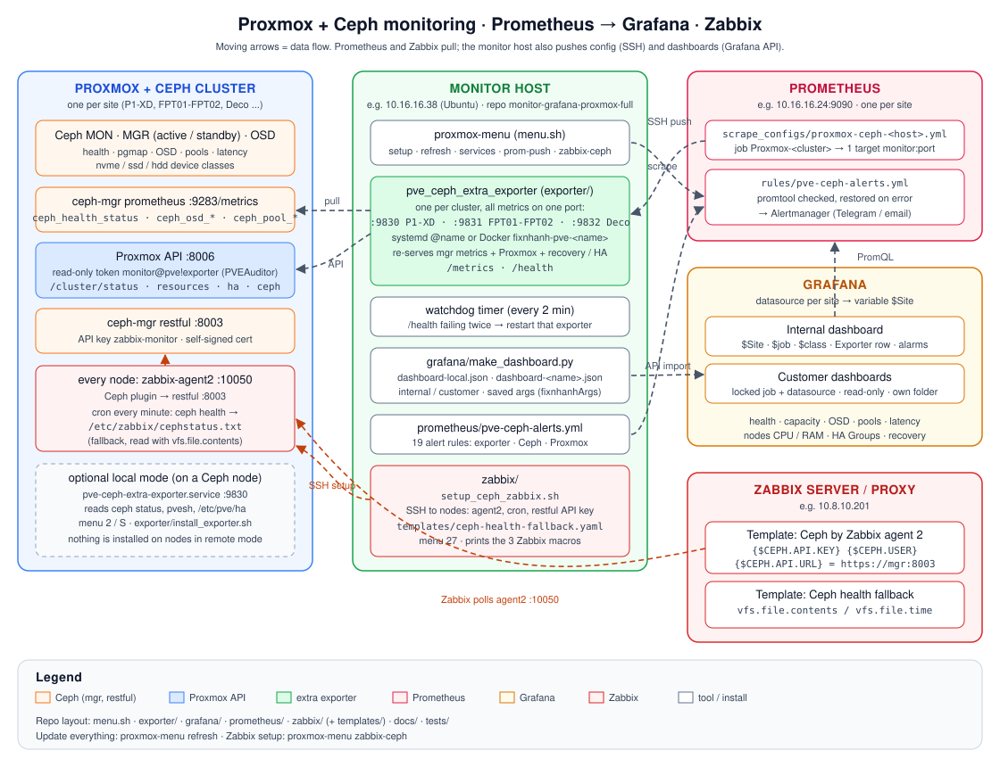

# Monitor Proxmox + Ceph (Prometheus / Grafana)



A toolkit that builds the **Proxmox - Ceph Prometheus** Grafana dashboard and fills every panel that used to show `No data`.

| Path | Purpose |
|---|---|
| `menu.sh` | **Management menu for everything** (`proxmox-menu`): checks, install, status, logs, dashboards, Prometheus, Zabbix, Docker, services |
| `exporter/` | `pve_ceph_extra_exporter.py` (recovery / rebalance, Total Health %, Recovery Speed, HA Groups; re-serves ceph mgr + Proxmox metrics on one port), `install_exporter.sh`, systemd unit `pve-ceph-extra-exporter@.service`, `Dockerfile` |
| `grafana/` | `make_dashboard.py` (dashboard generator) and `proxmox_ceph_dashboard.json` (default dashboard) |
| `prometheus/` | `pve-ceph-alerts.yml` — Prometheus alert rules: exporter, Ceph, Proxmox |
| `zabbix/` | `setup_ceph_zabbix.sh` (Zabbix Agent 2 for Ceph on every node over SSH) and `templates/ceph-health-fallback.yaml` |
| `docs/` | Architecture diagram |
| `tests/` | Unit tests (`python3 -m unittest discover -s tests`), run on GitHub Actions |
| `CHANGELOG.md` | Change log |

Generated on the host (not in git): `dashboard-local.json`, `dashboard-<name>.json`, `prometheus-scrape-all.yml`, `.menu.conf`, `.grafana-token`, `.grafana-cert.pem`.

## Why the old dashboard showed "No data"

| Panel | Cause | New version |
|---|---|---|
| OSD Used Class Nvme / HDD / HDD12T, Top 5 NVME/HDD/HDD12T Latency | The cluster has no OSD of that class, panels were hard-coded per class | Panels repeat over the `$class` variable (from `ceph_osd_metadata`), only existing classes are shown |
| Detailed Alarms | Cluster is HEALTH_OK so `ceph_health_detail` is empty | Shows `OK / HEALTH_OK / No alarms` |
| Ceph Status, Total Health, Recovery Speed | Nothing exported `ceph_custom_recovery_*` | `pve_ceph_extra_exporter` always exports them (100% / 0 B/s without recovery) |
| HA Groups column | `pve_ha_groups_custom_info` missing | The exporter reads `/etc/pve/ha/groups.cfg` and `rules.cfg` (PVE 9) |

Query bugs fixed from the old dashboard:
- **Resource Cluster with HA Groups** did not filter on `job` → nodes of every cluster on the same Prometheus were mixed.
- **OSDs OUT** computed `count(up) - count(in)`, always 0; now counts `ceph_osd_in == 0`.
- **OSD Used Class HDD12T** took its Low column from class `hdd`.

## Install: one command, asks once

Clone the repo on one Ceph node of each cluster (or on a separate monitor host, see *Remote monitoring*) and run:

```bash
git clone https://github.com/fixnhanh-linux/monitor-grafana-proxmox-full.git /root/monitor-grafana-proxmox-full
```

```bash
bash /root/monitor-grafana-proxmox-full/menu.sh setup
```

(or open the menu and pick **S**). The tool asks all questions below, prints a **SUMMARY**, asks `Start? (y/N)`, then runs every step and reports the result.

| # | Question | Default / detected | Used for |
|---|---|---|---|
| 1 | What is this host for: `1` full Ceph node · `2` exporter only · `3` dashboard only · `4` remote monitor | `1` | Which steps run |
| 2 | Exporter port | `9830` | The service's `/metrics` port |
| 2 | Serve all metrics on 1 port? | `Y` | `Y`: Prometheus needs only 1 target; `n`: keep separate ceph mgr / pve exporter targets |
| 2 | Prometheus job name | `Proxmox-<cluster_name>` from `/etc/pve/corosync.conf` | Sample `prometheus-target-<job>.yml` |
| 3 | Dashboard title, UID | `Proxmox - Ceph Prometheus`, `pve-ceph-prom` | Same UID overwrites the old dashboard |
| 3 | Site datasource regex, job regex | empty (all), `/.*Proxmox-/` | `$Site`, `$job` variables |
| 3 | Node / pool / device class counts | from `ceph osd tree`, `ceph osd pool ls`, `ceph osd crush class ls` | Table heights |
| 3 | Latency thresholds per class | `nvme=15:25,ssd=50:100,default=100:200` | Colors of the OSD latency tables |
| 3 | Default time range | `now-15m` | Time picker |
| 3 | Short names + colors for HA Groups? | group strings found in `/etc/pve/ha/` | HA Groups column, e.g. `Gold+HIGH:purple` |
| 4 | Grafana URL, token, folder UID | empty URL = JSON file only | Import over the API |
| 5 | Prometheus URL | empty = skip | Checks the target is `up` and the job matches ceph mgr |

Steps run by the tool (depending on answer 1):

1. Environment check — stops on errors, nothing installed yet
2. Install / update the `pve-ceph-extra-exporter` service
3. Print and save a sample `prometheus.yml` block (`prometheus-target-<job>.yml`)
4. Generate `dashboard-local.json` (not tracked by git, so updates are never blocked)
5. Import to Grafana
6. Check Prometheus

### Changing things later

| To change | How |
|---|---|
| Any answer | Run `proxmox-menu setup` again — current values are prefilled in `[ ]`, press Enter to keep them |
| Quick edit without questions | Edit `.menu.conf` (`DASH_TITLE=`, `DASH_LAT=`, `DASH_ALIASES=` ...) then run `proxmox-menu refresh` |
| Exporter port only | `proxmox-menu port 9300`, then update the target in Prometheus |
| Dashboard only | Menu **9** (generate) then **11** (import; the same UID overwrites) |
| HA Groups short names | Menu **9** → answer `y` to the HA Groups question; `DASH_ALIASES` is stored as `string=Name:color;;string2=Name2` |
| Remove the exporter | Menu **8** or `proxmox-menu uninstall` |

Grafana token: entered once in menu 11; if you choose to save it, it is kept in `.grafana-token` (root-only, not in git, not in `.menu.conf`). An invalid / expired token is deleted automatically and asked again; delete it by hand in menu 15.

## Update everything: one command, no questions

```bash
proxmox-menu refresh
```

Runs `git pull`, restarts itself on the new code, then with the saved config: reinstalls the exporter (local + every remote cluster, systemd or Docker) and restarts it, regenerates every dashboard file and imports it to Grafana (needs the Grafana URL + token saved in menu 11), prints the service table and checks Prometheus. It ends with `Done, no errors` or the list of steps that need attention.

## The `proxmox-menu` shortcut

The first time `bash /root/monitor-grafana-proxmox-full/menu.sh` runs as root, the tool creates `/usr/local/bin/proxmox-menu`. From then on, from any directory:

| Command | Purpose |
|---|---|
| `proxmox-menu` | Open the menu |
| `proxmox-menu refresh` | Update everything (git pull + exporter + dashboards + checks) |
| `proxmox-menu services` | Service table: restart / stop / logs |
| `proxmox-menu <command>` | Any command below (`remote-list`, `prom-push`, `docker-net` ...) |

If you move the tool folder, run `bash <new-folder>/menu.sh` once and the shortcut follows.

## Menu items

| Item | Purpose |
|---|---|
| S | Full setup (above) |
| 1 | Check python3, `ceph`, keyring, HA config, free port, PVE firewall |
| 2 | Install / update the exporter (asks for the port, default 9830) |
| 3 | Service status, collectors OK / failing, Ceph Status line, Total Health |
| 4 | Show metrics (one-shot run from source if not installed) |
| 5 / 6 / 7 / 8 | Logs, restart, change port, uninstall |
| 9 | Generate the dashboard — node / pool / device class counts read from Ceph. Pick **1 Internal** (all clusters) or **2 Customer** (see below) |
| 10 | Sample `prometheus.yml` for this node; with remote clusters, merges **all clusters** into `prometheus-scrape-all.yml` (checks each exporter, skips duplicate jobs, flags two configs for the same cluster), then optionally pushes it to the Prometheus host over SSH, with the alert rules (see below) |
| 11 | Import a dashboard to Grafana over the API (service account token, **Editor** role); checks first that Grafana has a Prometheus datasource matching the Site variable; with a self-signed Grafana cert it offers to **pin the cert** (compare SHA-256 with the browser) instead of disabling TLS checks; keeps the dashboard's current folder |
| 12 | Ask Prometheus: exporter targets `up`, exporter job matches the ceph mgr job, device classes per cluster |
| 13 | Full check (1 + 3 + 12) |
| 14 | Update the tool (`git pull`), offers to reinstall the exporter if it changed |
| 15 | Show / delete the saved config (`.menu.conf`), **set the Prometheus / Grafana URLs** (with a connection check) |
| 16 | About & license |
| 17 | Add / edit a remotely monitored cluster (API token) |
| 18 | Remote clusters: port, service, real cluster read, state of each part; red when two configs read the same cluster or share a job |
| 19 | Test one cluster's connection (explains 401 / 403 / firewall) |
| 20 | Remove a remote cluster (stops the service / container, deletes the token) |
| 21 | Install required packages — detects `apt` / `dnf` / `yum` / `zypper` / `pacman` / `apk` |
| 22 | Open the firewall for the Prometheus IP — detects `ufw` / `firewalld` / `pve-firewall` |
| 23 | Run clusters (added in 17) in Docker: builds the image, moves from systemd to a container on the same port |
| 24 | Manage containers: status, logs, restart, remove (back to systemd) |
| 25 | Change the Docker IP range (`docker0` + range for new networks): checks private range / route overlap, backs up `daemon.json`, restarts Docker, checks containers come back; restores the old file if Docker fails |
| 26 | **Services & health**: table of every exporter (local, `@cluster`, container) + Docker + watchdog with state, `/health`, port, start on boot; `r`/`s`/`t` restart / stop / start (one or `a` = all) then **verifies** active + `/health` within 40 s and prints logs on failure; `l` logs; `b`/`B` enable / disable start on boot; `w` watchdog |
| 27 | **Zabbix: Ceph via Zabbix Agent 2** — runs `zabbix/setup_ceph_zabbix.sh` (see *Zabbix* below) |

Run a single command without the menu: `proxmox-menu setup | check | install [port] | status | metrics | logs | restart | port <number> | uninstall | dashboard | import | prom | prom-check | doctor | update | refresh | about | remote-add [name] | remote-list | remote-test | remote-remove | prom-all | prom-push | prom-rules | urls | deps | firewall | docker-run | docker-manage | docker-net | services | watchdog | zabbix-ceph | ha-sync`.

The menu remembers the Grafana URL, Prometheus URL, dashboard title / UID in `.menu.conf`; the Grafana token (if saved) lives separately in `.grafana-token`.

## Remote monitoring: nothing installed on the Proxmox nodes

The exporter runs on a **monitor host** (e.g. 10.16.16.38, Ubuntu) and collects over the **Proxmox API** with a read-only token plus the ceph mgr `/metrics`. One monitor host can watch many clusters, each cluster being one `pve-ceph-extra-exporter@<name>` service on its own port (9830, 9831, ...). Metric names are identical to local mode, so **the dashboard does not change**.

| Data | Local mode (on a node) | Remote mode (monitor host) |
|---|---|---|
| Ceph metrics (OSD, pool, latency) | `ceph mgr services` → mgr:9283 | Tries `CEPH_MGR` in turn; empty = every node IP from `/cluster/status` (standby mgrs return nothing → skipped until the active mgr) |
| Nodes, CPU, RAM, uptime, HA | `pvesh`, `/etc/pve` | API `/cluster/status`, `/cluster/resources`, `/cluster/ha/status/manager_status` |
| Ceph Status / Recovery | `ceph status` | API `/cluster/ceph/status` |
| HA Groups | `/etc/pve/ha/*.cfg` | API `/cluster/ha/groups`, `/cluster/ha/rules` (PVE 9) |

### Step 1: on any node of each cluster (once)

```bash
pveum user add monitor@pve --comment "FIX NHANH monitor"
```

```bash
pveum acl modify / --users monitor@pve --roles PVEAuditor
```

```bash
pveum user token add monitor@pve exporter --privsep 0
```

```bash
ceph mgr module enable prometheus
```

`PVEAuditor` can only **read**. The token command prints the `value` (secret) **only once** — keep it.

### Step 2: on the monitor host

```bash
proxmox-menu remote-add
```

(or menu **17**, or full setup **S → 4**). The tool asks:

| Question | Example / default |
|---|---|
| Cluster name | `FPT-HCM` |
| Proxmox node IPs | `10.16.16.60,10.16.16.61,10.16.16.62` — fails over to the next node if one dies |
| Token ID / secret | `monitor@pve!exporter` / secret (hidden) |
| Does Proxmox have a valid cert? | `N` (Proxmox ships a self-signed cert) |
| Ceph mgr | Enter = auto-find the active mgr on every node (`:9283`) |
| Prometheus job name | `Proxmox-FPT-HCM` (must contain `Proxmox-`) |
| Port | next free port from 9830 |

The tool **tests the connection** and reports each part ✔ / ✘ (401 = wrong token, 403 = missing permission with the exact `pveum` command to fix it, refused / timeout = firewall), then saves `/etc/pve-ceph-extra-exporter/<name>.env` (chmod 600, root-only), starts the service and prints a sample Prometheus block (1 target `monitor-IP:port`).

The monitor host must reach **node:8006** and **mgr:9283**.

### Security & load

- The service runs as a **transient user** (`DynamicUser`), not root; read-only filesystem (`ProtectSystem=strict`); limited to `CPUQuota=25%`, `MemoryMax=256M`.
- The token only lives in the mode-600 `.env` file, never on the command line / in `ps`.
- Every 30 seconds: 5–6 API requests + 1 mgr request per cluster. Negligible load on Proxmox.

### Non-Ubuntu servers

| OS | Notes |
|---|---|
| Debian, Ubuntu, Rocky / Alma / RHEL 8+, Fedora, openSUSE, Arch | Full support: menu **21** installs packages, **17** adds clusters |
| CentOS 7 / RHEL 7 | Works; old systemd ignores `DynamicUser` so the service runs as root |
| Alpine, hosts without systemd, Windows (Docker Desktop / WSL2) | Use Docker: menu **17** then **23** |

Firewall (ufw / firewalld / pve-firewall): menu **22**, enter the Prometheus IP and every exporter port on the host is opened.

### Docker

Add the cluster in menu **17** (to get its config file), then menu **23**: the tool builds `fixnhanh/pve-ceph-exporter:<version>`, stops that cluster's systemd service and runs container `fixnhanh-pve-<name>` on the same port (256 MB / 0.25 CPU, read-only, all capabilities dropped). The Prometheus target does not change. Menu **24** shows logs / restarts / removes containers (back to systemd). `proxmox-menu refresh` rebuilds the image and recreates the containers when the exporter version changes.

Manual run without the menu:

```bash
docker build -t fixnhanh/pve-ceph-exporter exporter/
```

```bash
docker run -d --name fixnhanh-pve-FPT-HCM --restart unless-stopped -p 9830:9830 --env-file /etc/pve-ceph-extra-exporter/FPT-HCM.env fixnhanh/pve-ceph-exporter
```

## 1. Manual exporter install (on one Ceph node of each cluster)

```bash
scp -r exporter root@<proxmox-node>:/root/
```

```bash
bash /root/exporter/install_exporter.sh
```

Quick test without installing: `python3 pve_ceph_extra_exporter.py --once`

## 2. Add to Prometheus

### Default: all metrics on one port

The exporter re-serves the `/metrics` of the active ceph mgr (address from `ceph mgr services`) and exports Proxmox metrics from `pvesh` (same names as `prometheus-pve-exporter`: `pve_cluster_info`, `pve_up`, `pve_cpu_usage_ratio`, `pve_memory_*`, `pve_disk_*`, `pve_uptime_seconds`, `pve_ha_state`). Each cluster needs **one target**:

```yaml
  - job_name: Proxmox-DECO
    scrape_interval: 30s
    scrape_timeout: 25s
    static_configs:
      - targets:
          - 10.0.0.11:9830   # pve_ceph_extra_exporter (all metrics)
```

Requirement: the ceph mgr prometheus module is enabled (`ceph mgr module enable prometheus`); menu **1** checks it.

**Remove** the cluster's old `:9283` (ceph mgr) and `:9221` (pve exporter) targets from the job, otherwise every value is doubled. Menu **12** reports duplicates when a job has two targets exporting ceph or Proxmox metrics.

### Many clusters on one monitor host

Menu **10** (or `proxmox-menu prom-all`) merges every cluster into `prometheus-scrape-all.yml`, which already starts with `scrape_configs:`.

| Your Prometheus | How to add it |
|---|---|
| Split files: `prometheus.yml` has `scrape_config_files: [/etc/prometheus/scrape_configs/*.yml]` | Copy the **whole file** into that directory, e.g. `proxmox-ceph-<monitor-host>.yml` |
| Single file (default) | Paste the `- job_name:` blocks under `scrape_configs:` in `prometheus.yml` |

With split files, answer `y` to *Push the file to the Prometheus host over SSH* (or `proxmox-menu prom-push`). The tool:

1. SSHes to the Prometheus host (offers to create a key + `ssh-copy-id`; otherwise the password is asked once per run), checks the directory and `scrape_config_files`.
2. Lists existing jobs with the **same name** or the **same target** as the exporter and offers to **replace** them: backs up the whole directory to `/root/prom-bak-<time>` on the Prometheus host, removes exactly those job blocks, adds the exporter jobs under the same names (the dashboard keeps its job names).
3. Lists other `:9283` / `:9221` targets so you can remove them if they are the same cluster.
4. Copies the file and runs `promtool check config`; on error **everything is restored** and Prometheus is unaffected; otherwise it reloads.

The SSH host, config file and directory are remembered in `.menu.conf`.

After the scrape file, the tool offers to push the **alert rules** too (or `proxmox-menu prom-rules`): copies `prometheus/pve-ceph-alerts.yml` into the `rule_files` directory in use (read from `prometheus.yml`, e.g. `/etc/prometheus/rules/`). If `prometheus.yml` does not load that directory yet, the tool adds it to `rule_files` (keeps a `.bak`). If `promtool check rules` + `check config` fail, both files are restored.

The menu header shows the running commit (e.g. `2026.10.30 · de76e86`); when GitHub has a newer one it shows **New version → pick 14**.

### Not merged (keep the old targets)

Answer `n` to the merge question (service runs with `--no-ceph-mgr --no-pve`). The exporter target must be in the **same job** as the cluster's ceph mgr / pve exporter (the dashboard filters on `job=~"$job"`):

```yaml
  - job_name: Proxmox-DECO
    static_configs:
      - targets:
          - 10.0.0.11:9283   # ceph mgr prometheus (existing)
          - 10.0.0.11:9830   # pve_ceph_extra_exporter (new)
```

### Alert rules

`prometheus/pve-ceph-alerts.yml` ships these rules, applied to jobs containing `Proxmox-`:

| Group | Alert | When |
|---|---|---|
| Exporter | `PveCephExporterDown` | An exporter target cannot be scraped for 2 minutes (only targets of this exporter, not standby mgrs) |
| | `PveCephExporterCollectorFailed` | A collector fails for 5 minutes (matching dashboard panels show No data) |
| | `PveCephExporterStale` | No new collection for 3 minutes (ceph command / API hung) |
| Ceph | `CephHealthError` / `CephHealthWarning` | HEALTH_ERR 1 minute / HEALTH_WARN 15 minutes |
| | `CephOsdDown` / `CephOsdOut` | OSD down 5 minutes / out 15 minutes |
| | `CephOsdNearFull` / `CephOsdFull` | OSD used > 85% / > 90% |
| | `CephPoolNearFull` | Pool used > 80% |
| | `CephPgInconsistent`, `CephUnfoundObjects` | Inconsistent PGs / unfound objects |
| | `CephRecoveryTooLong` | Recovery / rebalance over 6 hours |
| | `CephOsdHighLatency` | Apply latency > 200 ms for 10 minutes |
| Proxmox | `PveNodeDown`, `PveClusterNotQuorate`, `PveHaNodeFenced` | Node offline, quorum lost, HA fence / lost |
| | `PveNodeHighCpu` / `PveNodeHighMemory` | CPU / RAM > 90% for 15 minutes |

To add them by hand, copy the file to the Prometheus host and add to `prometheus.yml`:

```yaml
rule_files:
  - /etc/prometheus/rules/pve-ceph-alerts.yml
```

```bash
promtool check rules /etc/prometheus/rules/pve-ceph-alerts.yml
```

Then reload Prometheus. Delivery (Telegram, email ...) is configured in Alertmanager. Thresholds and `for:` durations are edited directly in the file.

## 3. Generate and import the dashboard

```bash
python3 grafana/make_dashboard.py -o grafana/proxmox_ceph_dashboard.json
```

Options:

```bash
python3 grafana/make_dashboard.py --title "Proxmox - Ceph DECO" --uid pve-ceph-deco --site-regex "/^Prometheus (FPT HN|CMC-Q7)$/" --nodes 5 --pools 4 --classes 1
```

- `--site-regex`: Prometheus datasource filter for the **Site** variable
- `--job-regex`: job filter on `pve_cluster_info` (default `/.*Proxmox-/`)
- `--nodes / --pools / --classes`: table heights
- `--lat-th`: latency thresholds (ms) warning:critical per class, default `nvme=15:25,ssd=50:100,default=100:200`
- `--ha-alias "GROUPS=TEXT[:color]"` (repeatable): short name and color for an HA Groups string, e.g. `--ha-alias "Gold-6146,HIGH-FREQUENCY,P1-XD=Gold+HIGH+P1-XD:purple"`; nodes with a problem turn red / orange whatever the group color
- `--prom-url URL` / `--ha-group GROUPS`: groups without `--ha-alias` get an automatic color (never red / orange), **one color per CPU type**: model names inside the group string (a word + a 3+ digit model, e.g. `Gold-8260`, `Platinum-8260`, `EPYC-7543`) are detected, so `Gold-8260,HIGH-MEMORY,...,Platinum-8260` and `Gold-8260,...,Platinum-8260` share a color; groups without a model name are grouped by their first group (e.g. `BASIC-COMPUTING`); with `--prom-url` the group list is read from Prometheus each time the dashboard is generated. Menu 9 / `refresh` pass the saved Prometheus URL automatically
- `--color-state FILE`: remembers the color of each CPU type (menu uses `.ha-colors.json`, shared by every dashboard): existing types keep their color, a new type gets an unused one
- **New hosts / groups are colored automatically**: `refresh` installs the systemd timer `pve-ceph-ha-colors` (root + saved Grafana URL / token). Every 5 minutes it runs `proxmox-menu ha-sync`: when a new HA Groups string appears (new host, new group, new site) it regenerates and re-imports every dashboard. Log: `journalctl -t pve-ceph-ha-colors`
- `--time-from`: default time range, e.g. `now-5m`
- `--customer-job JOB`: customer dashboard (see below)
- `--regen FILE`: regenerate FILE with the arguments saved inside it

Import: Grafana → Dashboards → New → Import → upload the JSON file, or menu 11. Importing with an existing UID overwrites that dashboard.

## Multiple dashboards (one per Site group)

Every `dashboard-<name>.json` in the tool folder stores the arguments used to create it (`fixnhanhArgs`). `proxmox-menu refresh` regenerates and imports **all** of them, keeping each dashboard's current Grafana folder. Menu 11 lets you pick which file to import.

Create it once (take the UID from the existing dashboard URL `/d/<uid>/...`; the same UID overwrites that dashboard):

```bash
cd /root/monitor-grafana-proxmox-full && python3 grafana/make_dashboard.py -o dashboard-cmc.json --title "Proxmox - Ceph Prometheus CMC Q7 - FPT HCM - VIETTEL HCM - CMC HN" --uid fix --time-from now-5m --site-regex "/^(Prometheus FPT HCM|Prometheus FPT HN|Prometheus CMC-Q7|Prometheus VIETTEL HCM|Prometheus CMC HN)$/" --job-regex "/^(?!.*Proxmox-Cluster-DMS|.*Test|.*Deco).*Proxmox-/" --nodes 15 --pools 6 --ha-alias "BASIC-COMPUTING,INTEL-HIGH-CPU,P1-XD=BASIC+INTEL+P1-XD:purple" --ha-alias "Gold-6146,HIGH-FREQUENCY,P1-XD=Gold+HIGH+P1-XD:orange" --ha-alias "Gold-8260,INTEL-HIGH-CPU,P1-XD,Platinum-8260=Gold+INTEL+P1+Platinum:green" --ha-alias "Gold-8260,INTEL-HIGH-CPU,Platinum-8260=Gold+INTEL+Platinum:blue"
```

Regenerate one file with its saved arguments: `python3 grafana/make_dashboard.py --regen dashboard-cmc.json`.

## Customer dashboards

Menu **9** → `2` generates `dashboard-kh-<job>.json` for **one customer**:

| | Internal | Customer |
|---|---|---|
| Site / Job | Any datasource, any cluster | **Hidden**, locked to 1 datasource + 1 job |
| Health, capacity, OSD, pools, latency, recovery | ✔ | ✔ |
| Node CPU / RAM / uptime | ✔ | ✔ |
| Detailed Alarms (raw Ceph messages) | ✔ | ✘ |
| HA / HA Groups columns | ✔ | ✘ |
| Exporter row (collectors, errors, version) | ✔ | ✘ |
| Editing | Allowed | Locked (`editable: false`) |

The tool asks for the customer's job (listed from Prometheus), the customer name, the **Grafana datasource name** (matched exactly), title and UID `kh-<job>`. Grafana permissions: create a **folder** for the customer → import the dashboard into it (menu 11 asks which file and the folder UID) → grant the customer's users / team **Viewer on that folder**, not at the organization level. Hidden variables only hide the UI — if the customer must never query other clusters, give them a separate Grafana organization with its own datasource.

```bash
python3 grafana/make_dashboard.py --customer-job Proxmox-P1-XD --site-regex "/^Prometheus FPT HCM$/" --title "Customer P1-XD - Proxmox Ceph" --uid kh-p1-xd -o dashboard-kh-p1-xd.json
```

## Watchdog: restart hung exporters automatically

Menu **26** → `w` (or `proxmox-menu watchdog`) installs the systemd timer `pve-ceph-exporter-watchdog`, running **every 2 minutes**: it calls `/health` of every **running** exporter (local, `@cluster`, container `fixnhanh-pve-*`); hung (`503`) or no answer **twice in a row** restarts exactly that exporter. Services you stopped on purpose are not restarted. History: `journalctl -t pve-ceph-watchdog`. Run `w` again to turn it off and remove it.

## Zabbix: Ceph via Zabbix Agent 2

Independent of Prometheus / Grafana: Zabbix polls **zabbix-agent2** on every Proxmox node, whose built-in Ceph plugin reads the **ceph-mgr restful API** (`:8003`). A cron job on each node also writes `ceph health` to `/etc/zabbix/cephstatus.txt` every minute, as a fallback when the API is down.

Run from any host that can SSH to the nodes (e.g. the monitor host):

```bash
proxmox-menu zabbix-ceph
```

(menu **27**, or `bash zabbix/setup_ceph_zabbix.sh <zabbix-ip> <node1> <node2> ...`). It asks for the Zabbix server / proxy IP and the node IPs; SSH keys are used when present, otherwise the root password is asked once (`sshpass`, never shown in `ps`). On every node it:

1. Installs `zabbix-agent2` if missing (needs the Zabbix package repo) and sets `Server` / `ServerActive`, `Plugins.Ceph.InsecureSkipVerify=true` (keeps `zabbix_agent2.conf.bak`).
2. Installs `/etc/zabbix/cephstatus.sh` + a cron job every minute → `/etc/zabbix/cephstatus.txt`.
3. Restarts and enables the agent.

On the first node it enables the `restful` mgr module, creates the API key `zabbix-monitor` and a self-signed cert, then prints the three macros:

```text
{$CEPH.API.KEY} = <key>
{$CEPH.USER}    = zabbix-monitor
{$CEPH.API.URL} = https://<active-mgr>:8003
```

In Zabbix web (**Data collection → Hosts → host**):

| Template | How |
|---|---|
| `Ceph by Zabbix agent 2` | Built into Zabbix. Link it and set the three macros above (**Macros → Inherited and host macros**) |
| `Ceph health fallback by Zabbix agent 2` | Import `zabbix/templates/ceph-health-fallback.yaml` once (**Data collection → Templates → Import**, Zabbix 6.0+), then link it. Items: `vfs.file.contents[/etc/zabbix/cephstatus.txt]` (trigger: not `HEALTH_OK`), `vfs.file.time[...]` (trigger: not updated for 5 minutes) |

The fallback uses `vfs.file.contents`, so `AllowKey=system.run[*]` and `docfile.sh` from the old script are no longer needed (the script removes `docfile.sh`). If the restful module is not available on your Ceph version, the script says so — use the Prometheus / Grafana path instead.

## Exporter metrics

| Metric | Meaning |
|---|---|
| `ceph_custom_recovery_info{content,state}` | Status line; value 0 = OK, 1 = recovery / rebalance, 2 = error |
| `ceph_custom_recovery_percent` | % of data stable (100 without degraded / misplaced) |
| `ceph_custom_recovery_speed_bytes` | Recovery speed (bytes/s) |
| `ceph_custom_recovery_objects_per_sec` | Recovered objects / second |
| `ceph_custom_degraded_objects`, `_misplaced_objects`, `_unfound_objects` | Abnormal object counts |
| `ceph_custom_pgs_not_clean` | PGs not active+clean |
| `ceph_custom_progress_percent{event}` | Progress of `ceph progress` events |
| `pve_ha_groups_custom_info{host,groups}` | HA groups / node-affinity rules of the node (rules covering every node or disabled rules are ignored; a rule `comment` is shown instead of its `ha-rule-…` id) |

The **HA Groups** column of *Resource Cluster* is always shown; nodes in no group show `-`. Healthy nodes keep the group color; a problem overrides it:

| Color | Cell | When |
|---|---|---|
| Group color: `--ha-alias ...:color`, otherwise an automatic color per group | group name (or short name) | node up, HA online |
| Orange | `MAINTENANCE: ...`, `HA UNKNOWN: ...` | HA maintenance mode / HA state unknown |
| Red | `OFFLINE: ...`, `FENCE: ...` | node down (`pve_up = 0`) / HA fence, lost, gone |
| Grey | `-` | node in no group |

Exporter self-monitoring metrics (the **Exporter** row at the bottom of the dashboard):

| Metric | Meaning |
|---|---|
| `pve_ceph_extra_exporter_up{collector}` | 1 = collection OK. Collectors: `ceph_mgr`, `pve`, `ceph`, `ha` (`ceph_mgr` / `pve` absent with `--no-ceph-mgr` / `--no-pve`) |
| `pve_ceph_extra_exporter_last_error{collector,error}` | Last error of a failing collector (401, timeout, standby mgr ...) |
| `pve_ceph_extra_exporter_collect_seconds{collector}` | Duration of the last collection (seconds) |
| `pve_ceph_extra_exporter_last_collect_timestamp` | Time of the last collection (unix) — detects stale data |
| `pve_ceph_extra_exporter_mode{mode}` | `local` / `remote` |
| `pve_ceph_extra_exporter_build_info{version}` | Exporter version |

Besides `/metrics`, the exporter serves `/health`: `200 ok` while the last collection is recent, `503 stale` when the collection loop has been hung for more than `3 × INTERVAL` (at least 120 s). The Docker image uses it for `HEALTHCHECK`, so a hung container shows `unhealthy` in `docker ps`.

---

Copyright © 2026 **FIX NHANH**. All rights reserved — see [LICENSE](LICENSE).
